# Keine Explore Harness v1

> **文档性质**：技术报告 · **版本**：v1 · **日期**：2026-11-21
>
> **范围**：探索助手的业务模型（意图识别、信息检索、知识沉淀、信任与合规），以及支撑它的 Harness：运行时、工具循环、容错、提示词与上下文、搜索、工具、模型接入、用量统计、质量保障。
>
> **依据**：ADR 0008（助手运行在进程内，循环归 Keine）、ADR 0009（对话节点是实体）、ADR 0010（用量来自真实消耗）。

---

## 摘要

探索助手把「阅读中的理解」变成「可沉淀的知识」。读者在专栏正文中选中一段文字，助手先识别读者想理解什么，再在本讲、整门课程和网络三个层级上检索信息，最后生成一份结构固定的解读。解读可以固定成探索文档；读者围绕它在一棵对话树上继续追问，再把对话结论同步回文档。

支撑这条业务链路的是 **Keine Explore Harness v1**：一套运行在服务进程内的自研 Agent Harness。核心决策有五条：

1. **循环归 Keine，可替换的只有模型适配器。** 模型调用、工具执行、结果回填组成的循环由 Keine 掌握。适配器只负责「一次流式调用」，换服务商只换适配器。
2. **三条边界自有。** 保存的消息、流式事件、工具定义都是 Keine 的格式，服务商私有结构不越过适配器。
3. **检索失败不终止运行。** 工具错误分为四类，以工具结果的形式回填给模型，由模型决定后续动作。
4. **答案有保证。** 检索有步数预算和软、硬两道截止线。预算耗尽后转入作答，而不是报错。
5. **结构化输出靠标签加服务端校验。** 输出与服务商的结构化能力解耦，可以逐字流式输出、统一校验，不合格时有一次补救。

---

## 1. 业务背景

### 1.1 问题

阅读专业内容时，理解障碍集中在两类对象上：

- **术语**：概念名、缩写、专有名词。
- **语句**：论断、推理、机制描述。

这两类障碍有共同特点：

- **依赖语境**：同一个词在不同课程、甚至同一门课的不同讲里，含义可能不同。通用解释往往偏离文章的本意。
- **检索成本高**：离开页面去搜索、比对、回到原文，打断阅读。
- **理解难沉淀**：弄懂的结论散落在别处，与原文脱节，复习时找不回来。

### 1.2 目标

| 目标 | 衡量方式 |
| --- | --- |
| 就地理解 | 不离开阅读页；首字延迟低；过程可见 |
| 语境一致 | 解释以本讲语境为准，通用含义只作铺垫 |
| 检索可信 | 课程内信息优先；网络来源由服务端记录，不由模型编造 |
| 知识沉淀 | 解读能固定、追问、整理成结构化文档，挂在原文位置上 |
| 用量可度量 | 每次运行的 token 与搜索消耗都按真实值统计，可供上层使用 |
| 透明可信 | 读者知道发送了什么、发给了谁；AI 生成内容始终有标识 |

### 1.3 角色

| 角色 | 诉求 |
| --- | --- |
| 读者 | 理解、追问、沉淀；可以选择使用自有模型 |
| 管理员 | 配置模型与轮次映射，查看用量统计 |
| 部署者 | 控制并发与运行时长，决定是否开放读者自有模型，保障内网安全 |
| 开发者 | 改动提示词、模型、上下文后，能评估质量有没有退化 |

---

## 2. 业务全景

### 2.1 读者旅程

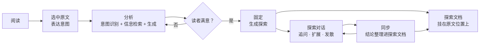

### 2.2 三种轮次类型

探索助手的所有交互都可以归为三种**轮次类型**，三者共用一个 Harness，区别在上下文、工具和输出契约：

| 轮次类型 | 业务含义 | 输入 | 检索 | 输出 |
| --- | --- | --- | --- | --- |
| **分析** | 对一处选区做首次解读 | 选区、标题路径、本讲正文、课程信息与目录 | 课程检索 + 网络检索 | 三段式解读：标题、简介、含义 |
| **后续轮** | 在探索对话中追问 | 固定时的快照、首轮回复、当前探索文档、祖先链上的对话 | 课程检索 + 网络检索 | 自由格式的回复 |
| **同步** | 把对话结论整理进文档 | 后续轮的上下文、文档各项的标识与来源、本链路的来源清单、同步指令 | 无 | 按段落划分的修改块 |

### 2.3 业务对象

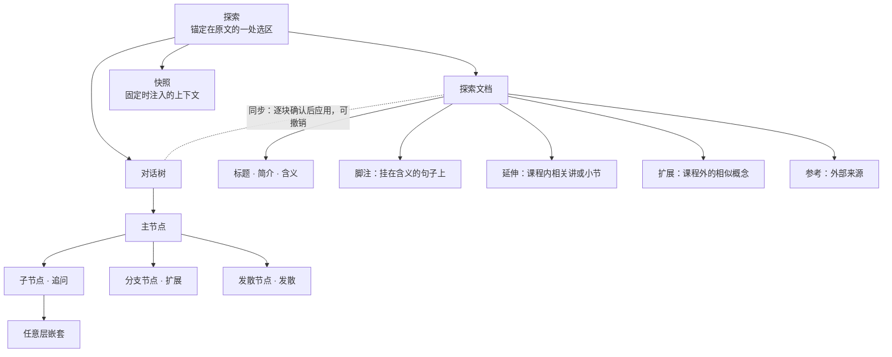

---

## 3. 意图识别

### 3.1 意图信号

v1 不设独立的意图分类模型。意图由**结构化信号**加**技能提示词**共同确定：服务端把信号放进上下文，模型按提示词中的策略理解它们。这样识别结果直接体现在输出里，不需要额外的一次调用。

| 信号 | 来源 | 表达的意图 |
| --- | --- | --- |
| 选区粒度 | 选中的文字本身 | 术语级，指向概念定义；语句级，指向论断或机制 |
| 选区位置 | 选区在正文中唯一定位，并标出所在的标题路径 | 限定解释的语境范围 |
| 轮次类型 | 读者触发的入口：分析、提问、同步 | 首次理解、深入讨论、整理归纳 |
| 节点类型 | 开新节点时读者的选择 | 子节点追问细节；分支节点扩展到相关主题；发散节点联想到更远的领域 |
| 重点片段 | 开节点或同步时，读者在回复中圈出的片段 | 讨论或整理的焦点 |
| 同步指令 | 是否补充参考、重点片段 | 整理的范围与深度 |
| 正文语言 | 本讲正文 | 输出语言 |

### 3.2 从意图到输出策略

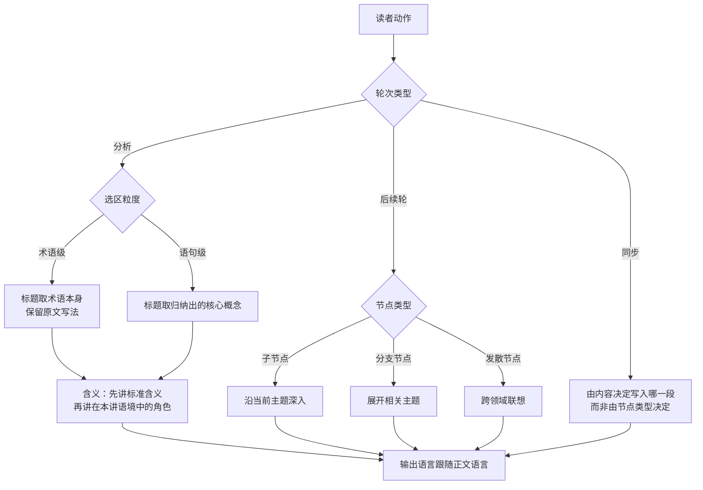

### 3.3 语境锚定

意图识别的关键在于把「这段文字」精确对应到「这一讲的这一处」：

- **视觉文本到源文的映射**：读者选中的是渲染后的文字。服务端把它映射回 Markdown 源文，在全文中用定界标记包住被选中的那一处；同一段文字在本讲出现多次时，只标读者选中的那一处。
- **标题路径**：选区上方各级标题组成的路径单独给出，帮助模型判断选区属于哪个论述单元。
- **可见性**：选区只能落在读者可以标注的讲里，原文必须能在正文中定位到，否则在运行开始前就拒绝。

---

## 4. 信息检索

### 4.1 分层检索模型

助手的信息来源分四层，从近到远、从可信到需要核验：

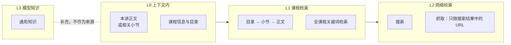

| 层级 | 触发方式 | 可信度 | 来源记录 |
| --- | --- | --- | --- |
| L0 上下文内 | 运行开始时注入 | 最高：读者正在读的内容 | 快照 |
| L1 课程检索 | 模型按需调用课程工具 | 高：同一门课程，读者可见的版本 | 讲和小节的稳定标识 |
| L2 网络检索 | 模型按需调用搜索、抓取 | 需要核验 | 服务端生成的来源清单 |
| L3 模型知识 | 隐式 | 不可追溯 | 不作为参考来源 |

### 4.2 检索策略

- **模型自主决策**：检不检索、检索什么，都由模型在工具声明下自主决定（`tool_choice: auto`），不强制检索。
- **预算约束**：检索有步数上限、单步并发上限和时间截止线，预算耗尽后转入作答（见第 9 章）。
- **避免重复读取**：本讲正文已在上下文中，提示词和工具描述都要求不再读取本讲；同一讲的正文在一次运行内只读一次。
- **由粗到细**：长文档先取目录，再按小节读取；整讲读取超过上限时截断，并引导模型按小节读取。
- **权限内检索**：课程检索只覆盖当前课程中读者可见的版本，包括下架后读者保留的讲；未上线、无文字正文、读者未保留的讲都不可读。
- **来源可追溯**：网络来源由服务端按实际执行的搜索和抓取生成清单，模型无法引入清单之外的链接。

### 4.3 长正文的上下文选择

本讲正文过长时，由读者在质量和成本之间取舍：

| 选项 | 注入内容 | 适用 |
| --- | --- | --- |
| 相关小节（默认） | 选区所在小节、相邻小节、本讲小节目录 | 绝大多数场景；时延和 token 消耗更低 |
| 完整正文 | 本讲全文 | 需要全局理解；标明时延和 token 消耗更高 |

软阈值和硬上限都由模型的上下文窗口推出：硬上限 = 窗口 − 输出与工具余量，窗口未配置时按 128k 计。超过软阈值时，请求必须携带读者的选择；超过硬上限时，「完整正文」不可选。组装后的输入仍超过窗口，就返回 `context_too_long`。

---

## 5. 知识沉淀

### 5.1 固定

分析结束后，结果先暂存在服务进程内存中：快照、最终回复和校验通过的三段，加一个不透明的分析 ID。固定时前端只提交这个 ID：

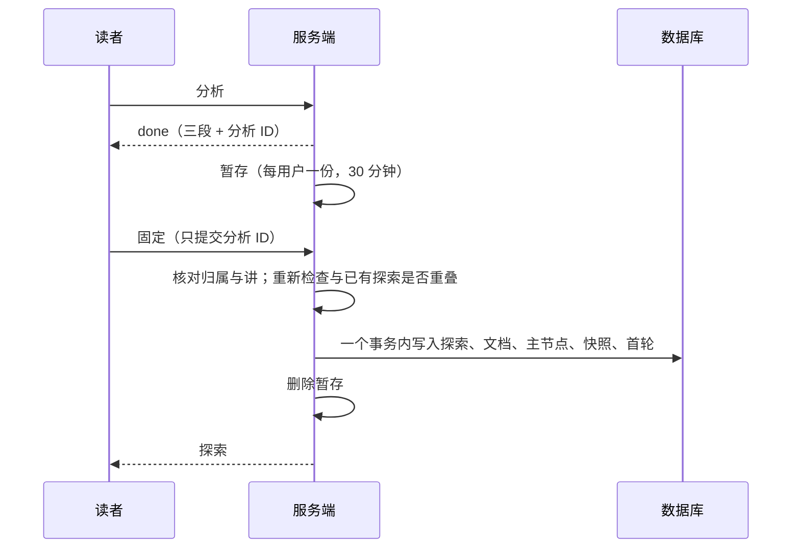

设计要点：

- **固定的就是读者看到的那一份**，不重新生成。
- **防伪造**：前端提交不了回复或三段内容。这些内容会进入之后每一轮的上下文，而服务商接口无法分辨历史里的助手轮次是否被伪造。
- **不留痕**：没固定的分析不写库。新分析开始即替换旧的暂存；暂存过期后返回 `analysis_expired`。
- **暂存位置**：服务进程内存，每用户一份，30 分钟过期；前端只持有不透明的分析 ID。[^sel-stash]

### 5.2 探索对话

对话以**节点**为实体组织成一棵树：

- **线性节点**：同一节点内的轮次是线性的；某一轮失败后原地重试，不产生兄弟版本。
- **岔出可见性**：新节点从某一轮岔出，只看到岔出点之前的对话，父节点之后的内容和兄弟节点都不可见。
- **上下文顺序**：快照 → 首轮回复 → 当前探索文档 → 沿祖先链的历史（含各节点首问附带的重点片段）。
- **快照不变**：课程更新改动了正文，对话仍以固定时的快照为依据。
- **上限**：每份探索最多 50 个节点，不限层数；删除非主节点时连同后代一起删除。

### 5.3 同步

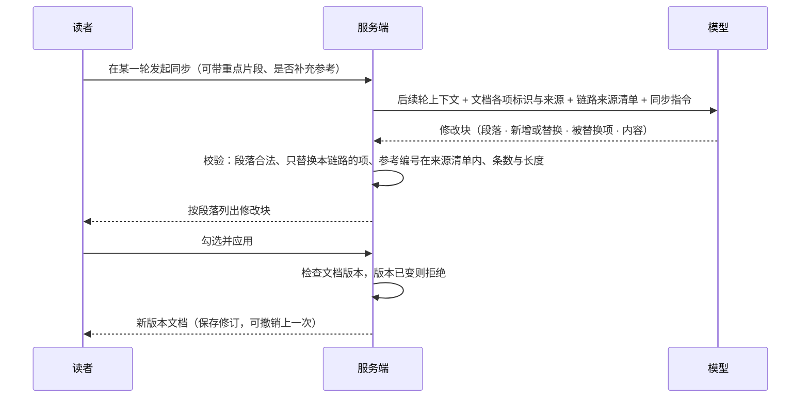

| 规则 | 设计 |
| --- | --- |
| 写入位置 | 由内容决定：改写含义，新增或替换脚注、延伸、扩展、参考 |
| 隔离 | 只能替换本链路写入的项，不影响其他分支的内容 |
| 参考 | 只在读者要求时补充，且只能引用来源清单中的条目 |
| 脚注 | 含义被改写后，脚注仍挂在对应的句子上；找不到对应句子时挂到含义末尾 |
| 并发 | 文档版本已变时拒绝应用（`document_changed`）；暂存 30 分钟后过期（`sync_expired`） |
| 条数上限 | 脚注 12、延伸 8、扩展 10、参考 20；达到上限后只能替换已有的项 |

---

## 6. 信任与合规

- **告知**：读者首次使用时，说明会发送的内容（选区、本讲正文、课程名称与目录、提问与探索文档、搜索词）、不会发送的内容（标注、笔记、其他探索），以及发送的去向。读者点击分析即视为已读，跨设备同步。
- **标识**：AI 生成的内容始终标明生成方和服务商。
- **凭据保护**：模型凭据用主密钥加密存储，界面只回显末 4 位；未配置主密钥时不能保存凭据。
- **网络边界**：读者自有模型的地址只允许公网 HTTPS；内网网段要在部署者的白名单中才放行；云元数据地址始终拦截。判断在建立连接时针对实际解析出的每个 IP 进行，不跟随重定向。
- **数据最小化**：推理原文、服务商签名、运行中的工具调用与结果都不落库；系统提示词只记版本。

---

## 7. Harness 总体架构

### 7.1 组件视图

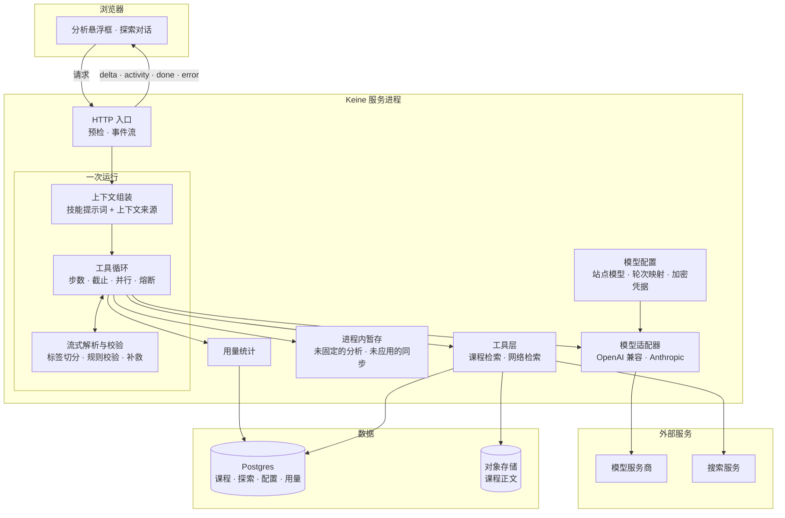

### 7.2 职责划分

| 组件 | 职责 |
| --- | --- |
| HTTP 入口 | 校验权限与选区，执行运行前检查；解析本轮使用的模型；开启事件流；连接断开即取消运行 |
| 上下文组装 | 按轮次类型声明的上下文来源和顺序组装请求；提示词带版本号 |
| 工具循环 | 调用模型、执行工具、回填结果；管理步数、截止时间、并行、熔断、取消 |
| 流式解析与校验 | 逐字切分标签并推送；结束时按规则校验；不合格时补救 |
| 工具层 | 课程检索工具；网络搜索与抓取，路线按模型解析 |
| 用量统计 | 逐次调用采集统一用量，按步与按运行汇总，写入用量明细（见第 16 章） |
| 模型配置 | 站点模型的增删改、连接测试、轮次类型映射、凭据加密 |
| 模型适配器 | 完成一次流式调用，输出统一的增量、工具调用、用量和结束原因 |
| 进程内暂存 | 保存未固定的分析和未应用的同步，30 分钟过期 |

### 7.3 运行架构

Harness 以进程内自写循环的形式运行在 Keine 服务进程中，可替换的单位只有模型适配器。[^sel-runtime]

- **循环归 Harness**：模型调用、工具执行、结果回填、步数、截止时间、取消、逐步计量、输出校验都在循环内。
- **适配器只做一次流式调用**：交出统一的增量、完整的工具调用、统一用量和结束原因。
- **工具经运行上下文取数**：工具直接通过运行上下文访问课程数据，权限只在一处保证。
- **服务商覆盖靠网关补足**：Harness 只依赖 base URL，其余服务商通过部署者的模型网关接入。

---

## 8. 运行时

### 8.1 一次运行的生命周期

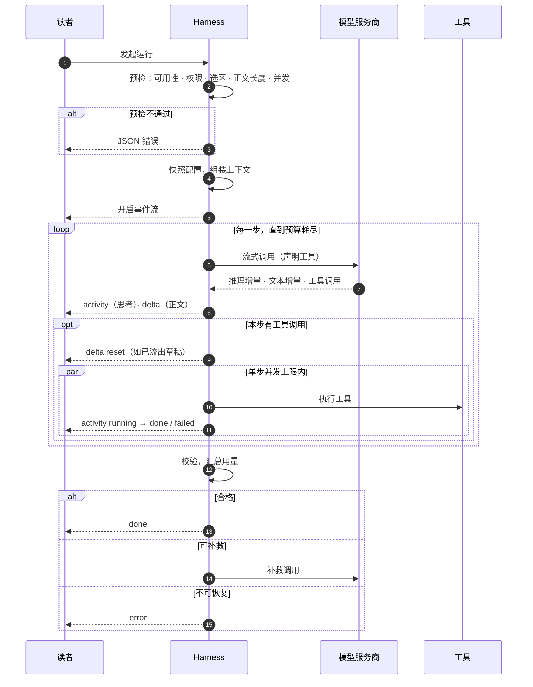

### 8.2 运行上下文与快照

- **运行上下文**：用户、课程、讲、选区。工具只能通过运行上下文访问数据，权限由 Harness 保证，不依赖模型的约束。
- **配置快照**：模型、地址、凭据、思考开关、单价在运行开始时读取，运行期间不变。
- **提示词版本**：每种轮次类型的提示词都带版本号；保存的消息只记版本，不存原文。

### 8.3 时间模型

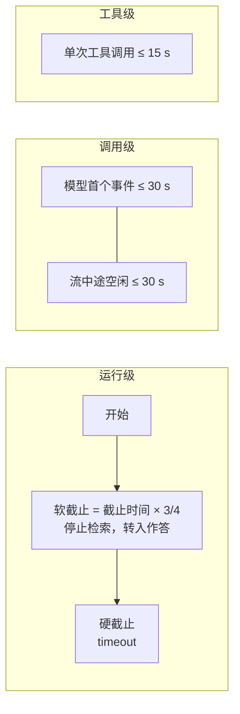

| 约束 | 值 | 超出时 |
| --- | --- | --- |
| 运行截止时间 | 默认 120 s，部署者用环境变量设置 | 软截止：后续调用不再允许用工具；硬截止：返回 `timeout` |
| 模型首个事件、流中途空闲 | 各 30 s | 视为连接失败，进入模型调用的重试规则 |
| 单次工具调用 | 15 s | 视为工具临时故障 |

截止时间同时按真实时钟和注入时钟判定，测试时拨动时钟即可复现截止行为。

### 8.4 流式事件协议

请求为 `POST`，响应为 `text/event-stream`。事件只有四种，服务商的原始片段一律不透传：

| 事件 | 字段 | 语义 |
| --- | --- | --- |
| `delta` | 段名、文本、可选 `reset` | 正文增量。`reset` 表示已流出的草稿作废，前端清空正文，恢复显示进度 |
| `activity` | `id`、种类、目标、状态、失败原因、是否读者自有凭据 | 一次工具调用或一段思考的进度；文案由前端生成 |
| `done` | 结果；可带 `degraded` | 校验通过的最终结果 |
| `error` | 错误码、提示语、已流出内容是否保留 | 运行无法继续 |

推理原文从不推送；模型推理期间只发一条种类为「思考」的 `activity`。

### 8.5 隔离与护栏

| 机制 | 设计 |
| --- | --- |
| 取消 | 连接断开即取消运行；已消耗的用量照常计入 |
| panic 隔离 | 工具执行和进度目标计算中的 panic 都在循环内接住，转为内部错误，进程不受影响 |
| 全局并发 | 默认 16，由环境变量设置；满载时直接返回 `busy`，不排队；读者自有模型也计入 |
| 每用户并发 | 1；再次发起返回 `run_in_progress` |
| 重启语义 | 重启中断进行中的运行，丢弃未固定的分析和未应用的同步 |

---

## 9. 工具循环

### 9.1 循环结构

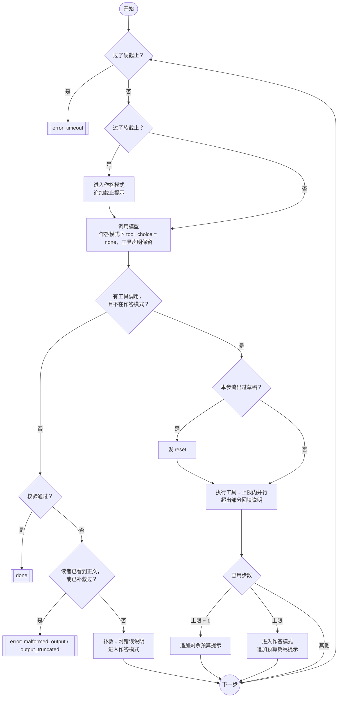

### 9.2 规则与理由

| 规则 | 设计 | 理由 |
| --- | --- | --- |
| 最终答案 | 没有工具调用的那一步 | 不依赖强制工具调用，适用于所有服务商[^sel-output] |
| 步数预算 | 6 次带工具的调用，之后一次作答调用；最后一次检索前提示剩余预算 | 限制成本与时延，同时保证一定产出答案 |
| 作答调用 | 保留工具声明，设 `tool_choice: none`；服务商不支持时由适配器移除工具 | 中途改动工具列表会让缓存失效；部分服务商在历史含工具调用、请求却不带工具时，会把原始的工具调用标记写进正文 |
| 并行 | 单步最多 5 个工具调用同时执行，结果按原顺序回填 | 降低时延，同时防止单步过载 |
| 草稿作废 | 某一步写了标签却以工具调用结束时，发 `reset` | 读者不会看到前后矛盾的内容 |
| 推理回传 | 一次运行内，推理内容原样带回后续调用；不落库，不跨运行 | 满足服务商的回传要求，服务商签名不进入保存格式 |

### 9.3 典型的一步

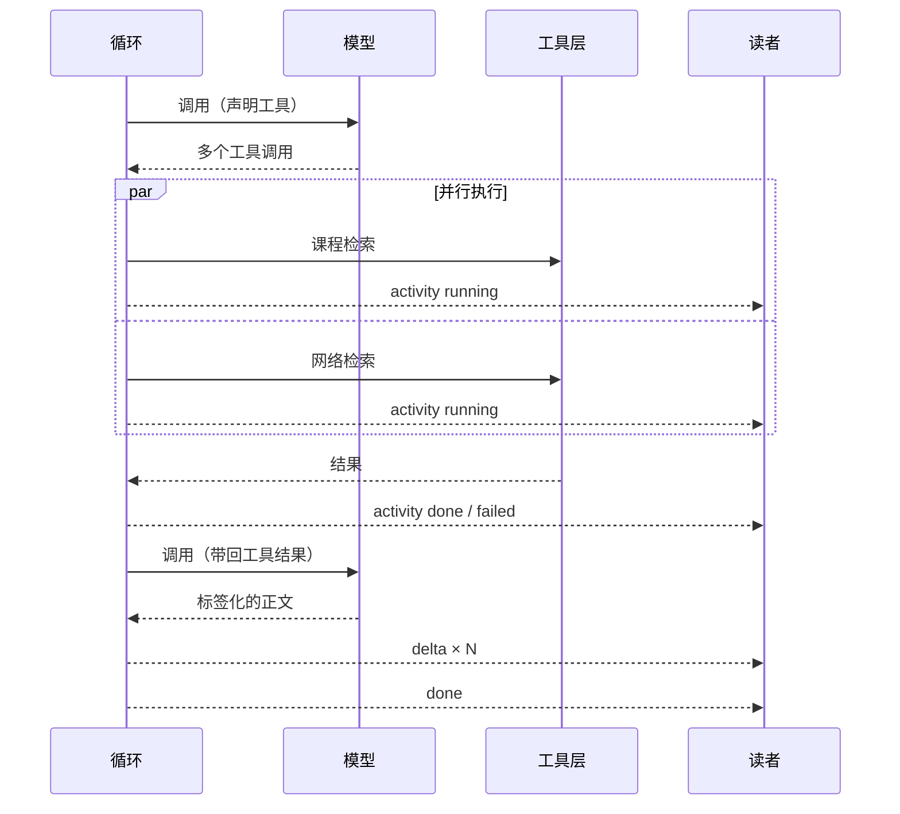

---

## 10. 重试与容错

### 10.1 分层容错

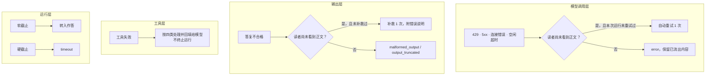

### 10.2 工具错误的四类

| 类别 | 触发 | 处理 | 回填给模型 |
| --- | --- | --- | --- |
| 调用错误 | 参数不合法；目标不存在或读者不可见；URL 不在本次搜索结果中 | 不重试 | 错误原因和修正方法 |
| 临时故障 | 超时、429、5xx、网络错误 | 同步重试 1 次，短退避，服务端要求的等待只在几秒以内才照办；重试不占步数 | 调用暂时失败 |
| 账户问题 | 余额不足、凭据无效 | 不重试，本次运行内熔断该能力 | 能力不可用，要求依据已有资料作答、不得编造来源 |
| 内部错误 | panic、数据库错误 | 记录日志，不暴露内部细节 | 一句通用说明 |

空结果和截断都**不算**失败：检索无命中、结果为空都是正常结果。

### 10.3 熔断

熔断以「能力」为单位，只在本次运行内有效：

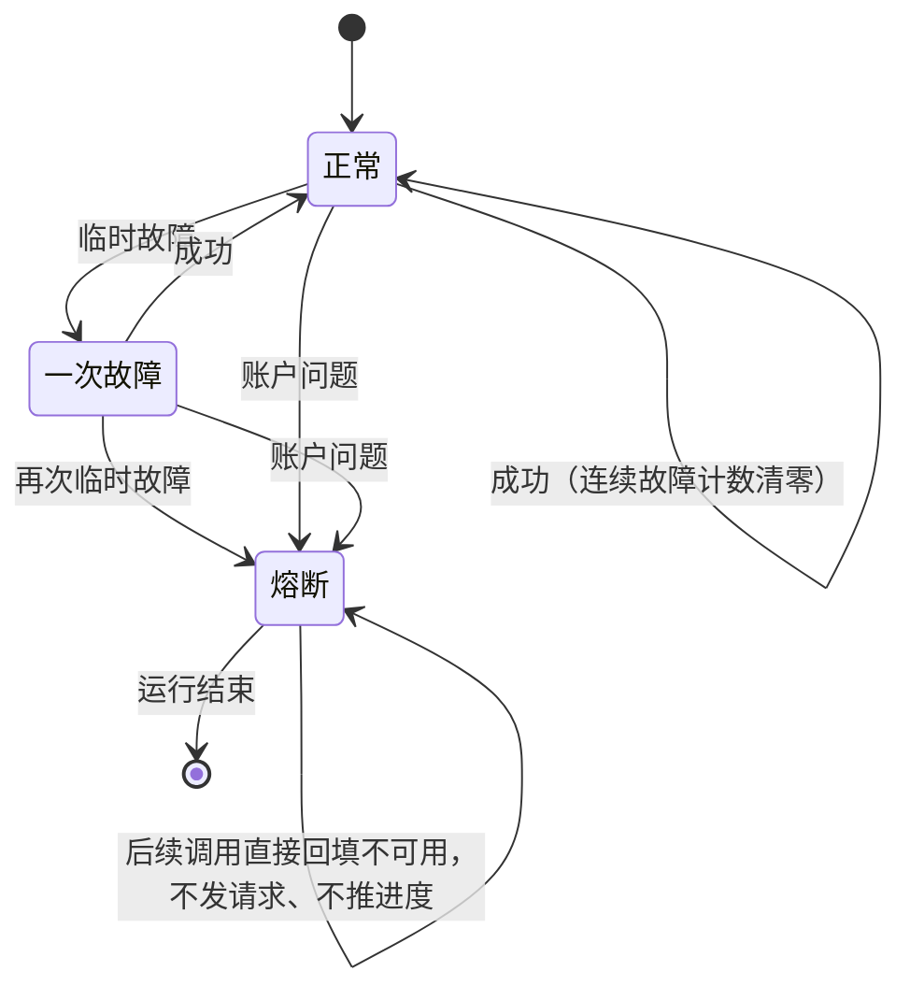

熔断后工具仍保留在声明中，以免缓存失效。

### 10.4 错误码

| 时机 | 错误码 |
| --- | --- |
| 开始前（JSON 响应） | `ai_unavailable` · `not_annotatable` · `quote_not_found` · `overlap` · `length_choice_required` · `context_too_long` · `busy` · `run_in_progress` · `node_limit` |
| 运行中（`error` 事件） | `provider_error` · `rate_limited` · `timeout` · `malformed_output` · `output_truncated` · `own_model_error` |
| 暂存与并发 | `analysis_expired` · `sync_expired` · `document_changed` |

每个运行中的错误都带「已流出内容是否保留」：保留时内容留在界面上，并提供重试。

---

## 11. 系统提示词与上下文组装

### 11.1 技能 = 提示词 + 工具集

技能由一段系统提示词和一组工具组成，在组装上下文时由 Harness 注入，不依赖任何运行时自带的技能机制。每种轮次类型声明自己的上下文来源和顺序；来源清单跟随提示词版本，版本记入消息元数据。

### 11.2 上下文顺序与缓存


- **稳定前缀**：最不常变的内容放在前面。同一门课程的所有分析共享「系统提示词 + 课程信息 + 课程目录」这一段前缀，可以命中缓存。
- **跨运行的缓存边界**：前缀只延伸到本次运行开始时的用户消息；推理内容不在其中。
- **后续轮**：快照 → 首轮回复 → 当前探索文档 → 祖先链历史，不放兄弟节点。
- **同步**：在后续轮的上下文之外，再加上文档各项的标识和来源、链路上各轮的来源清单、同步指令。

### 11.3 分析技能的输出约束

| 部分 | 约束 |
| --- | --- |
| 标题 | 术语级选区取术语本身，原文写法保留在括号中；语句级选区取归纳出的概念名；20 字以内 |
| 简介 | 1–2 句，80 字以内，纯文本 |
| 含义 | 先讲标准含义，再讲在本讲语境中的角色；不写标题，不用加粗行充当小标题；300–700 字 |
| 图示 | 只在流程、状态、结构难以用文字说清时使用，最多一张，类型限竖向流程图、时序图、状态图 |
| 范围 | 首轮只写含义；延伸、扩展、参考由同步产生；不写链接 |
| 语言 | 跟随本讲正文的语言 |
| 检索 | 按需检索其他讲；不重读本讲；预算有限，检索完即作答 |

### 11.4 推理模式

每种轮次类型可以单独开关思考。开启时，输出上限从 4096 提高到 8192 token；推理过程只以「思考」状态呈现，推理内容只在本次运行内回传。

---

## 12. 输出规范与校验

### 12.1 输出方案

分析结果以三段标签包裹，配合流式标签解析器和服务端校验；没有工具调用的那一步即为最终答案；预算耗尽后，发一次保留工具声明、禁止使用工具的作答调用。这一方案不依赖任何服务商的结构化输出能力，正文可以逐字流式，格式规则由 Harness 掌握。[^sel-output]

### 12.2 流式解析

解析器是一个逐字扫描的状态机：

- 标签外的文字不推送，也不保存；
- 标签被切在两个流式块之间时暂扣，凑完整后再处理；
- 段首、段尾的空白不推送；
- 同一段重复出现时，判为不合格。

同步的修改块同样用带属性的标签包裹。解析器能容忍属性值使用中文弯引号。

### 12.3 校验规则

| 维度 | 规则 |
| --- | --- |
| 结构 | 三段各有完整的开闭标签；标题、简介非空 |
| 简介 | 不含标题，不含列表 |
| 含义 | 不含标题、单独一行的加粗字、链接、裸 URL、SVG |
| 图示 | 最多一个 Mermaid 代码块，类型受限；前端以严格安全级别渲染，渲染失败时退回代码块，不算不合格 |
| 长度 | 标题 ≤ 100 字，简介 ≤ 300 字，含义与笔记的上限相同 |
| 兜底 | 出现原始的工具调用标记时判为不合格 |
| 截断 | 因长度上限被截断时判为不合格（`output_truncated`） |
| 同步修改块 | 段落合法；只替换本链路的项；参考编号在来源清单内；脚注 ≤ 1000 字，延伸、扩展每项 ≤ 300 字，参考标题 ≤ 200 字 |

### 12.4 补救

答复不合格且读者尚未看到正文时，自动补一次调用：附上不合格的答复和错误说明，要求严格按格式重新作答。补救调用不允许使用工具。补救仍不合格，或读者已经看到正文时，报错并交由读者重试。

---

## 13. 搜索策略

### 13.1 能力与路线

联网搜索和网页抓取是两项**能力**。每次运行开始时，按当前模型为每项能力解析出一条路线：

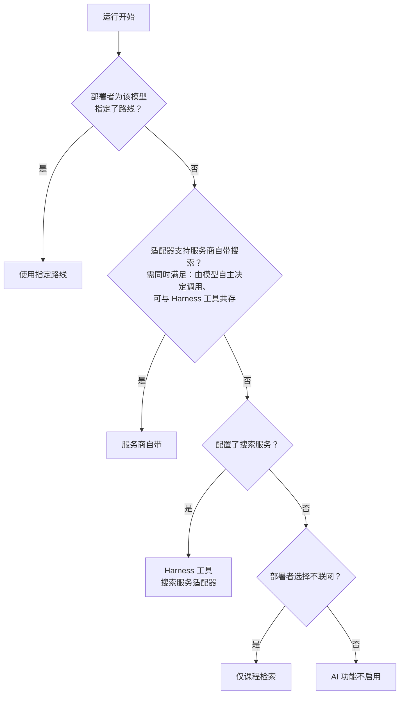

| 模型类型 | 搜索 | 抓取 |
| --- | --- | --- |
| Anthropic Messages | 服务商自带 | 服务商自带 |
| DeepSeek 服务商配置 | DeepSeek Search API，与模型共用凭据 | DeepSeek Fetch API，与模型共用凭据 |
| 其他 OpenAI 兼容模型 | Tavily，使用站点凭据 | 不提供 |

服务商自带搜索必须同时满足两个条件才会被采用：由模型自主决定调用，并且能与函数工具在同一请求中共存。[^sel-search]

### 13.2 路线规则

| 规则 | 设计 |
| --- | --- |
| 自主调用 | 搜不搜由模型决定（`tool_choice: auto`），不强制 |
| 抓取范围 | 只能抓取本次运行搜索结果中出现过的 URL |
| 熔断后 | 搜索熔断后，抓取仍可处理已获得的 URL |
| 降级提示 | 有能力熔断时，`done` 带 `degraded`；熔断且本次运行没有任何来源时，界面提示没有拿到网络结果，不写入探索文档和保存的消息内容 |
| 服务商自带路线的错误 | 不重试、不熔断；错误统一映射为 Harness 的失败原因 |
| 来源清单 | 服务端按实际执行的搜索和抓取生成（标题、URL、种类），记入元数据；它是「参考」的唯一来源，不进入模型上下文 |
| 计费口径 | 只统计搜索服务实际计费的请求；失败、重试、熔断短路的调用都不计 |
| 结果限额 | 每次搜索 5 条，每条摘要 ≤ 500 字；抓取的正文截断到 20,000 字并加标记 |
| 内容判定 | 拿不到可读正文（类型不支持、页面打不开、超过大小上限）才算失败 |

---

## 14. 工具体系

### 14.1 工具契约

| 要素 | 说明 |
| --- | --- |
| 名称与描述 | 面向模型，说明用途和使用时机 |
| 入参 Schema | 由结构化类型自动生成；解析严格，多余、缺失、类型错误的参数都按调用错误处理，并把 Schema 回给模型 |
| 进度目标 | 面向读者，表示这次调用的对象（讲与小节的标题、检索词、站点） |
| 执行 | 只通过运行上下文访问数据；失败按四类分类 |

各家 tools 格式的转换由适配器完成。

### 14.2 工具清单

工具按检索层级分为两组：课程检索工具（L1）和网络检索工具（L2）。

| 工具 | 层级 | 能力 | 副作用 | 计入搜索次数 |
| --- | --- | --- | --- | --- |
| `list_sections` | L1 | 获取一讲的小节结构 | 无 | 否 |
| `read_lesson` | L1 | 读取一讲或其中一个小节 | 无 | 否 |
| `search_course` | L1 | 全课程关键词检索 | 无 | 否 |
| `web_search` | L2 | 网络搜索 | 写入来源清单；登记可抓取 URL | 是（按计费口径） |
| `web_fetch` | L2 | 网页正文抓取 | 写入来源清单 | 是（按计费口径） |

所有工具共用以下约定：

- **参数解析严格**：未知参数、缺失必填参数、类型错误都按调用错误处理（`invalid_request`），并把参数 Schema 回给模型。
- **空结果是正常结果**：无命中、无结果都不算失败，也不触发熔断。
- **单次超时 15 s**：超时按临时故障处理。
- **输出面向模型**：结果是带标识的结构化文本，每条结果都带可以继续调用的标识（讲标识、小节标识、URL）。

#### 14.2.1 list_sections：小节结构

**用途**：在读取长讲之前获取它的结构，为按小节精读提供标识。是「由粗到细」检索的第一步。

**参数**

| 参数 | 类型 | 必填 | 说明 |
| --- | --- | --- | --- |
| `lesson` | 字符串 | 是 | 讲标识，取自上下文中课程目录给出的标识 |

**执行流程**

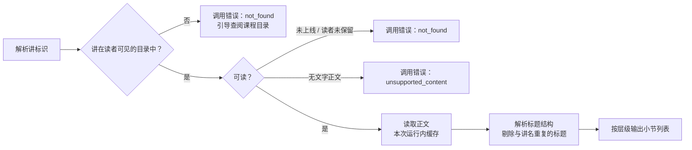

**返回结构**

- 讲标识与讲标题；
- 小节列表：每项包含小节标识和标题，按标题层级缩进；缩进以本讲最浅的一级标题为基准。
- 没有小节标题时返回正常结果，引导模型直接整讲读取。

**进度目标**：讲标题。

#### 14.2.2 read_lesson：正文读取

**用途**：读取一讲的全文，或其中一个小节，获取 L1 层的原文依据。上下文中已经有本讲正文，所以工具描述和技能提示词都要求不重读本讲。

**参数**

| 参数 | 类型 | 必填 | 说明 |
| --- | --- | --- | --- |
| `lesson` | 字符串 | 是 | 讲标识 |
| `section` | 字符串 | 否 | 小节标识，取自 `list_sections` 的返回；不填则读整讲 |

**执行流程**

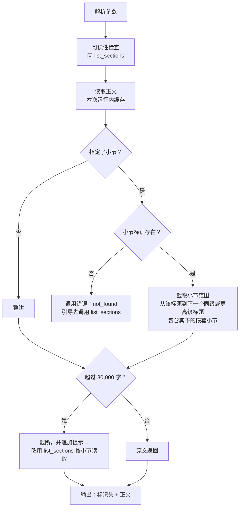

**返回结构**

- **标识头**：讲标识、讲标题、所属章；读小节时再加上小节标识与小节标题；
- **正文**：Markdown 原文，首尾空白已去除；
- **截断提示**：只在截断时出现，指出被省略的部分，并给出按小节读取的方法。

**小节范围的定义**：从小节标题所在行开始，到下一个层级相同或更高的标题之前为止，嵌套的下级小节包含在内。这个定义和阅读页的标题导航一致。

**进度目标**：讲标题；读小节时为「讲标题 › 小节标题」。

#### 14.2.3 search_course：课程检索

**用途**：在整门课程的正文中定位关键词，回答「这个概念在课程里哪里出现过」。命中结果带讲和小节标识，模型可以接着调用 `read_lesson` 精读。

**参数**

| 参数 | 类型 | 必填 | 说明 |
| --- | --- | --- | --- |
| `query` | 字符串 | 是 | 关键词；去除首尾空白后不能为空 |

**执行流程**

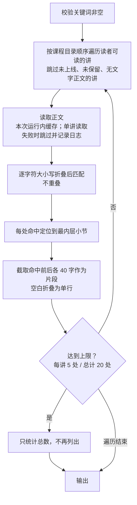

**返回结构**

- **汇总行**：关键词、命中总数；有命中未列出时，注明列出的条数；
- **命中列表**：每条包含讲标识、讲标题、最内层小节的标识与标题（不在任何小节内时省略），以及命中处的上下文片段；
- **无命中**：返回正常结果，说明课程正文中没有该关键词。

**匹配语义**：

- **大小写折叠**：逐字符折叠，保证命中位置和原文严格对应；
- **匹配对象**：Markdown 原文，所以代码块和表格里的内容也能检索到；
- **命中计数**：同一讲内的多处命中分别计数。

**进度目标**：关键词。

#### 14.2.4 web_search：网络搜索

**用途**：获取课程之外的资料（L2），用于解释通用概念、补充背景，以及在同步时补充参考。只有能为本次运行解析出 Harness 工具路线时才会声明；走服务商自带路线时，由服务商执行搜索，适配器把过程映射为同样的进度事件和来源记录。

**参数**

| 参数 | 类型 | 必填 | 说明 |
| --- | --- | --- | --- |
| `query` | 字符串 | 是 | 检索词，最多 128 字；为空或超长按调用错误处理 |

**执行流程**

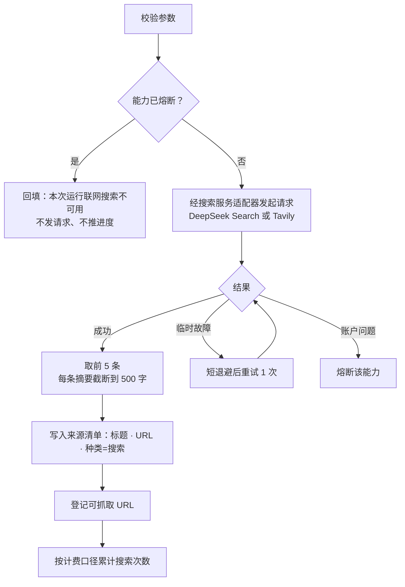

**返回结构**：每条结果包含标题、URL、摘要；结果为空时返回正常结果。

**计费判定**：由搜索服务适配器负责。DeepSeek Search 只统计返回成功且有结果的请求；Tavily 统计返回成功的请求。失败、重试、熔断短路的调用都不计入。

**进度目标**：检索词。

#### 14.2.5 web_fetch：网页抓取

**用途**：读取搜索结果中某个网页的正文，获取比摘要更完整的依据。

**参数**

| 参数 | 类型 | 必填 | 说明 |
| --- | --- | --- | --- |
| `url` | 字符串 | 是 | 必须是本次运行搜索结果中出现过的 URL |

**执行流程**

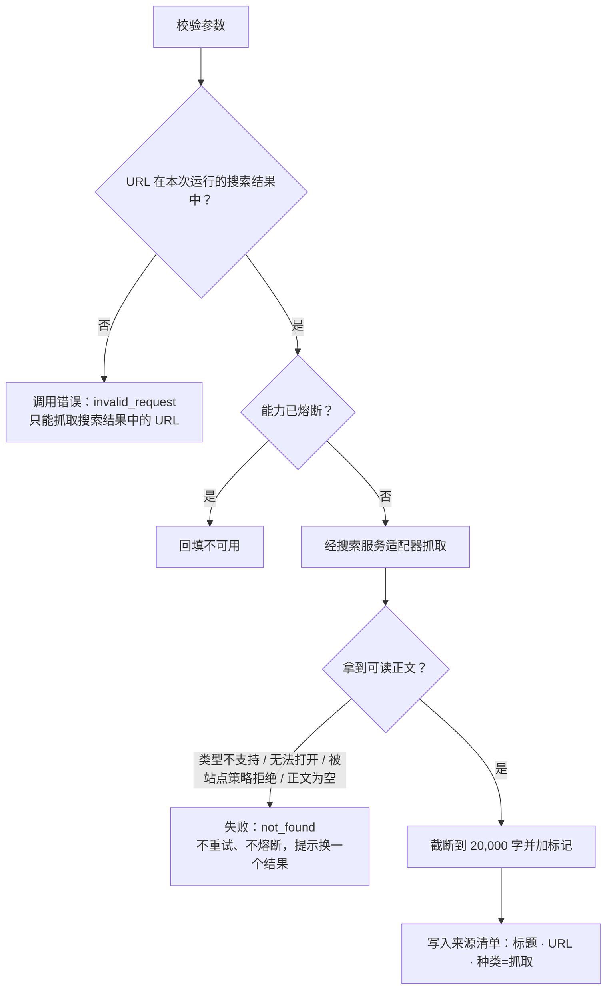

**返回结构**：页面标题、URL、正文（截断时带标记）。截断仍算成功。

**约束**：

- **抓取范围**：只能抓本次运行搜索结果中出现过的 URL，杜绝模型臆造地址，也把服务器主动访问的范围限定在搜索结果之内；
- **熔断隔离**：搜索熔断后，抓取仍可处理已经登记的 URL；
- **凭据**：DeepSeek 路线与模型共用凭据；其他 OpenAI 兼容模型的路线不提供抓取。

**进度目标**：URL 的站点部分。

### 14.3 标识体系

- **讲**：使用课程清单中的稳定标识，跨版本不变。课程目录在上下文中直接给出每讲的标识。
- **小节**：由标题文本生成，算法与阅读页的标题锚点一致，所以生成的站内链接能直接定位。与讲名重复的一级标题不算小节。

### 14.4 进度呈现

```mermaid
stateDiagram-v2
  [*] --> 进度列表: 首个 activity
  进度列表 --> 进度列表: 同类并行调用合并为一条计数
  进度列表 --> 正文流式: 首个 delta
  正文流式 --> 进度列表: reset
  正文流式 --> 完成: done
  完成 --> 完成: 进度折叠为一行计数摘要，可展开
```

- **失败项**：单独标记。
- **凭据归属**：使用站点凭据时，只提示该能力不可用；使用读者自有凭据时，提示具体的余额或凭据问题。
- **熔断短路**：被熔断短路的调用不单独显示。

---

## 15. 模型接入层

### 15.1 适配器边界

适配器是唯一可替换的单位。一次流式调用向上交付：

- 文本增量与推理增量；
- **完整的**工具调用（分块拼装在适配器内完成）；
- 统一用量：输入、输出、缓存命中、缓存写入四项互不重叠，另附「其中推理」的参考小计；服务商未报告的项为空；
- 结束原因：正常结束、长度截断、工具调用、内容过滤、其他；
- 失败类别：超时、限流、服务商余额不足、鉴权、不可用、不存在、请求不合法、响应不可读。原始错误只写入服务端日志。

Harness 内置两个适配器：OpenAI 兼容（Chat Completions，自写 HTTP 与流解析）和 Anthropic Messages（基于官方 SDK）。单个服务商的差异通过服务商配置吸收，不新增适配器。[^sel-model]

### 15.2 兼容性吸收

| 差异 | 处理 |
| --- | --- |
| 工具调用名在每个分块中重复出现 | 只取一次 |
| 续传分块缺少 index，甚至缺少 id | 依次按 id、index、最近一个调用来归属 |
| 用量在每个分块中重复报告累计值 | 取最后一次，不累加 |
| 用量挂在最后一个内容块上，或单独成块 | 两种都读取 |
| 推理字段名不统一 | 兼容常见的字段名 |
| 服务商余额不足以 429 返回 | 按响应内容识别为余额不足，而不是限流 |

### 15.3 服务商配置

服务商配置是挂在通用适配器上的一组默认值和规则，**不是新的适配器**：

| 规则 | DeepSeek |
| --- | --- |
| 默认值 | 自动填入地址和显示名称，管理员只需提供凭据和模型名 |
| 思考开关 | 按轮次类型映射中的开关发送 |
| 推理回传 | 一次运行内回传，不跨运行 |
| 用量映射 | 读取缓存命中和未命中两个字段；推理 token 计入输出 |
| 搜索路线 | Harness 工具，接入 DeepSeek Search 与 Fetch，共用模型凭据 |

接入其他服务商时扩展的是服务商配置，不新增适配器。

Anthropic Messages 适配器自己吸收的差异：

| 差异 | 处理 |
| --- | --- |
| 缓存 | 系统提示词末尾一个缓存标记，另加请求级的自动缓存标记，同一次运行里每次调用都延续上一次的前缀 |
| 思考 | 开关打开时使用自适应思考，关闭时不声明思考；思考块连签名作为只在内存里的原生内容，同一次运行的后续调用原样回传 |
| 暂停的一轮 | 服务商在自带搜索中途暂停时，适配器在同一次调用里把这一轮（含加密的搜索结果）原样发回续传，次数有上限；向上只交出一条消息，用量是各次请求之和 |
| 服务商自带搜索 | 声明搜索和抓取两项服务商工具，较早的模型用不带动态过滤的版本，每次调用各有次数上限；抓取的 URL 来源只允许本次运行的搜索结果 |
| 搜索过程 | 每次搜索或抓取在开始和出结果时各交出一个步骤，循环转成进度事件；搜索结果、抓取的页面、正文里的引用归一成来源清单 |
| 搜索出错 | 结果里的错误码映射成同一套失败原因（限流、请求不合法、不存在、内容不支持、不可用），不重试、不熔断 |
| 搜索计费 | 服务商用量里的搜索请求数计入搜索次数；抓取只按 token 计费，不计次数 |
| 重试 | 不使用官方 SDK 自带的重试，是否重试由循环决定 |

### 15.4 模型配置

- **站点模型**：存在数据库中，由管理员在管理页增删改。配置项包括接口格式、服务商配置、地址、凭据、模型名、显示名称、上下文窗口、四项 token 单价与搜索单价、搜索路线、能力声明（是否支持 `tool_choice: none`、并行工具调用、缓存标记）。
- **连接测试**：保存前发一次带假工具的流式请求，验证鉴权、流式、工具声明是否可用。
- **轮次类型映射**：分析、后续轮、同步各自映射到一个模型和一个思考开关。没配单价的模型不能被映射，保证每次运行的用量都能折算。
- **可用性**：三种轮次类型都已映射，且每个模型都能解析出搜索路线（或部署者选择不联网）时，AI 功能才对读者开放。
- **读者自有模型**：复用同样的适配器和服务商配置。出错时报 `own_model_error`，不回退到站点模型。能力取保守默认：OpenAI 兼容格式不开并行工具调用、不加缓存标记；Anthropic 格式加缓存标记。

---

## 16. 用量统计

用量统计记录每次运行的真实资源消耗，作为上层策略（成本控制、配额、运营分析）的唯一数据来源。Harness 只负责准确地采集、汇总和记录用量，不承载任何上层策略。

### 16.1 统一用量模型

| 字段 | 含义 | 说明 |
| --- | --- | --- |
| 输入 | 未命中缓存的输入 token | 不含缓存命中部分 |
| 缓存命中 | 命中缓存的输入 token | — |
| 缓存写入 | 写入缓存的输入 token | 只有支持显式缓存的服务商才报告 |
| 输出 | 输出 token | 包含推理 token |
| 其中推理 | 输出中的推理 token | 参考小计，不单独计价 |
| 搜索次数 | 搜索服务实际计费的请求数 | Harness 工具路线由搜索服务适配器判定；服务商自带路线由模型适配器从服务商用量里读出 |

- **四项互不重叠**：输入、缓存命中、缓存写入、输出四项 token 互不重叠，相加即为总消耗。
- **缺失可辨**：服务商没有报告的字段记为空，而不是 0，以便区分「没有」和「没报告」。

### 16.2 采集与汇总

```mermaid
flowchart LR
  subgraph 调用级
    A["适配器<br/>读取服务商用量字段"] --> B["映射为统一用量"]
  end
  subgraph 运行级
    B --> C["按步累加"]
    S["搜索服务适配器<br/>计费判定"] --> C
    C --> D["运行汇总"]
  end
  subgraph 持久化
    D --> E["× 运行开始时快照的单价<br/>折算成本"]
    E --> F[("用量明细<br/>每次运行一行")]
  end
```

| 环节 | 设计 |
| --- | --- |
| 字段映射 | 各服务商的用量字段由适配器映射：缓存命中有单独字段的直接读取；只报告「输入中的缓存部分」的，先从输入中扣除再记录；推理 token 计入输出，另记小计 |
| 流式用量 | 用量重复报告累计值时取最后一次；用量单独成块或挂在最后一个内容块上，两种都读取 |
| 按步累加 | 每次模型调用（包括重试、补救、作答调用）都单独采集并累加；上层可以在任意一步之后读取累计值 |
| 中断 | 连接断开、截止时间到、出错时，已消耗的部分照常计入；拿不到服务商报告时按本地估算，并标记为估算 |
| 单价快照 | 运行开始时读取模型的单价，运行中不变；明细同时保存原始用量和折算结果，单价调整不影响历史记录 |

### 16.3 预估

部分运行开始前需要估算用量，供上层决定是否放行：

| 项 | 估算方法 |
| --- | --- |
| 输入 | 首次请求的输入 token |
| 缓存命中 | 首次输入 × 3（后续步骤复用前缀） |
| 输出 | 2,000 token；开启思考时 4,000 token |
| 搜索 | 2 次 |

### 16.4 用量明细

| 字段 | 说明 |
| --- | --- |
| 用户 | 发起运行的读者 |
| 轮次类型 | 分析、后续轮、同步 |
| 模型 | 运行使用的站点模型 |
| 四项 token 与推理小计 | 统一用量 |
| 搜索次数 | 计费口径下的次数 |
| 折算成本 | 按运行开始时的单价计算 |
| 是否估算 | 有无采用本地估算 |
| 时间 | 运行结束时间 |

- **不存正文**：明细只记数量，不记提示词、回复或检索内容。
- **读者自有模型**：这类运行不写明细，也不能使用站点的搜索服务凭据。
- **统计视图**：管理员可以查看全站按天汇总（运行次数、四项 token、搜索次数、折算成本），以及每个用户当天和近 30 天的用量。

## 17. 质量保障

### 17.1 测试策略

| 切入点 | 手段 | 覆盖 |
| --- | --- | --- |
| HTTP API | 启动完整实例和独立数据库；注入脚本化模型（按脚本输出增量、工具调用、错误和延迟，并记录收到的每个请求）、可控时钟、可注入故障的工具 | 事件序列与 reset；步数预算与作答调用；软、硬截止；并发上限；四类工具错误与熔断；panic 隔离；上下文顺序；检索的权限与版本 |
| 模型适配器 | 本地回放录制的服务商流 | 统一事件、用量（含缓存与推理小计）、结束原因、工具调用拼装、兼容性差异 |
| 前端逻辑 | 单元测试 | 事件到界面状态的映射；进度合并与摘要 |
| 界面 | 演示实例加浏览器自动化；拦截接口模拟慢速流 | 进度、草稿作废、失败标记、摘要展开 |

测试只观察外部行为：HTTP 请求与响应、事件序列、之后接口读到的状态，以及模型收到的请求内容。不测内部函数，不 mock 数据库。关键规则还用变异检查验证：故意破坏某条规则时，测试必须失败。

### 17.2 质量评估：keine-eval

```mermaid
flowchart LR
  Y["用例集"] --> E["keine-eval"]
  DB[("内部环境<br/>真实课程数据")] --> E
  E --> H{"硬规则"}
  H -- 失败 --> F["判定退化"]
  H -- 通过 --> ST["统计指标与基线对比"]
  ST --> BL["盲评<br/>新旧版本并排、顺序打乱"]
  BL --> OK["接受并更新基线"]
```

| 方面 | 设计 |
| --- | --- |
| 运行方式 | 命令行工具；复用真实的循环、上下文组装、提示词、校验和课程读取；只读：不固定、不写用量明细、不登录 |
| 用例 | 每条由课程、课程版本、讲、选区原文定义，可附必含或必不含的关键词；分析、后续轮、同步各有一组，覆盖技术、非技术、外文三类课程 |
| 硬规则（必须为 0） | 服务端校验、图示可解析、标题语言、修改块与条数、关键词 |
| 统计指标 | 步数、工具调用次数、是否重读本讲、补救次数、耗时、首字时间、token、搜索次数 |
| 盲评 | 新旧版本并排展示，先看内容再揭示版本；每条用例运行 2 次 |
| 基线 | 仓库只保存统计基线，不含正文；变化在评审中可见 |
| 边界 | 不使用 LLM 评判；不进入 CI；真实模型只在评估中调用 |

---

## 18. 取舍与边界

### 18.1 设计取舍

| 取舍 | 说明 |
| --- | --- |
| 进程内运行 | 部署简单、边界自有；代价是重启会中断运行，并发靠全局上限、单用户上限和截止时间兜底 |
| 进程内暂存 | 未固定的分析不进数据库，不留痕；代价是重启后丢失，与流式中断等价 |
| 服务商自带搜索 | 检索质量更好；代价是每接入一家，都要吸收其结果格式、引用、计费字段和互斥规则 |
| 推理不落库 | 服务商签名不进入保存格式；如果服务商强制跨运行回传，退路是后续轮关闭思考，而不是保存推理 |
| 沙箱类工具 | 不在本架构内；需要执行代码等能力时，重新评估独立进程方案 |

### 18.2 v1 边界

以下内容不属于 v1：

- 深度研究模式（几分钟以上的长运行）、断线续接；
- 跨课程检索；检索读者的标注、笔记和其他探索；
- 读者自选技能；对话中临时切换模型或思考开关；
- 引用其他节点；编辑提问后重新生成兄弟版本；长历史自动摘要；
- 按课程禁止发送给 AI 的开关；
- 基于用量的上层成本控制策略（另行设计，依托第 16 章的用量统计）；
- LLM 评判、评估进入 CI。

---

## 附录 A：数值总表

| 项 | 值 | 设定方式 |
| --- | --- | --- |
| 全局并发上限 | 16 | 环境变量 |
| 运行截止时间 | 120 s；软截止为其 3/4 | 环境变量 |
| 每用户同时运行数 | 1 | 固定 |
| 步数预算 | 6 次带工具的调用 + 1 次作答调用 | 固定 |
| 单步并行工具调用 | 5 | 固定 |
| 工具调用超时 | 15 s | 固定 |
| 模型首个事件、流中途空闲 | 各 30 s | 固定 |
| 最大输出 | 思考关 4096 token，思考开 8192 token | 固定 |
| 整讲读取 | 30,000 字 | 固定 |
| 课程检索命中 | 每讲 5 处，共 20 处 | 固定 |
| 网络搜索结果 | 每次 5 条，每条摘要 ≤ 500 字 | 固定 |
| 抓取正文 | 20,000 字 | 固定 |
| 分析结果长度 | 标题 100 字，简介 300 字，含义与笔记上限相同 | 固定 |
| 文档条数 | 脚注 12，延伸 8，扩展 10，参考 20 | 固定 |
| 节点数 | 每份探索 50 个，不限层数 | 固定 |
| 未固定的分析、未应用的同步 | 30 分钟 | 固定 |
| 上下文窗口缺省值 | 128k | 固定 |

## 附录 B：术语

| 术语 | 含义 |
| --- | --- |
| 运行 | 一次分析、后续轮或同步，从请求开始到 `done` 或 `error` |
| 轮次类型 | 分析、后续轮、同步，各自映射到一个模型 |
| 步 | 一次带工具的模型调用，以及它触发的工具执行 |
| 作答调用 | 预算耗尽或过了软截止之后，不允许使用工具的那次调用 |
| 补救调用 | 答复不合格、读者尚未看到正文时，自动追加的一次调用 |
| 技能 | 一段系统提示词加一组工具 |
| 能力 | 联网搜索、网页抓取；每次运行按模型解析为一条路线 |
| 熔断 | 某项能力在本次运行内停用 |
| 适配器 | 完成一次流式调用、屏蔽服务商差异的模块 |
| 服务商配置 | 挂在通用适配器上的一组默认值和规则 |
| 快照 | 固定时注入的上下文，此后的对话以它为依据 |
| 来源清单 | 服务端按实际执行的搜索和抓取生成的来源记录 |
| 探索 | 锚定在原文选区上的知识单元，包含探索文档和对话树 |

## 附录 C：参考资料

- ADR 0008：探索助手运行在进程内，工具循环归 Keine，可替换的只有模型适配器
- ADR 0009：对话节点是实体
- ADR 0010：用量来自真实消耗
- 调研报告：服务商能力差异、Agent 运行时选型、参考实现、结构化输出、自有 API 应用的联网搜索、推理内容回传、未固定首轮的暂存、分支对话
- 外部参考：流式消息解析的标签状态机方法；流式工具调用的增量追踪方法

## 附录 D：技术选型扩展文档

每份文档阐述该选型时期的候选架构、架构图、优劣对比，最后总结选择原因。

| 编号 | 选型 | 结论 | 文档 |
| --- | --- | --- | --- |
| 选型一 | Agent 运行架构 | 进程内自写循环 | [01-runtime-architecture.md](selections/01-runtime-architecture.md) |
| 选型二 | 模型接入与适配器实现 | 两个原生适配器 + 服务商配置 | [02-model-access.md](selections/02-model-access.md) |
| 选型三 | 结构化输出与最终答案判定 | 标签包裹 + 流式解析 + 服务端校验 | [03-structured-output.md](selections/03-structured-output.md) |
| 选型四 | 未固定结果的暂存 | 进程内存暂存，凭 ID 固定 | [04-unpinned-result-stash.md](selections/04-unpinned-result-stash.md) |
| 选型五 | 联网搜索路线 | 按模型解析：服务商自带或 Harness 工具 | [05-web-search-route.md](selections/05-web-search-route.md) |

[^sel-runtime]: 候选架构与选择原因见附录 D 选型一：[Agent 运行架构](selections/01-runtime-architecture.md)。
[^sel-model]: 候选方案与选择原因见附录 D 选型二：[模型接入与适配器实现](selections/02-model-access.md)。
[^sel-output]: 候选方案与选择原因见附录 D 选型三：[结构化输出与最终答案判定](selections/03-structured-output.md)。
[^sel-stash]: 候选方案与选择原因见附录 D 选型四：[未固定结果的暂存](selections/04-unpinned-result-stash.md)。
[^sel-search]: 候选方案与选择原因见附录 D 选型五：[联网搜索路线](selections/05-web-search-route.md)。
