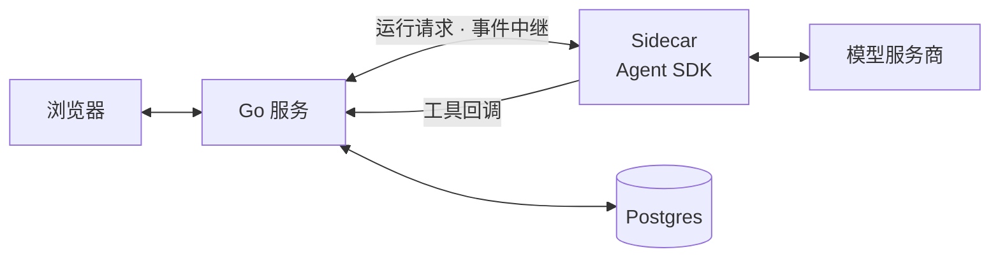
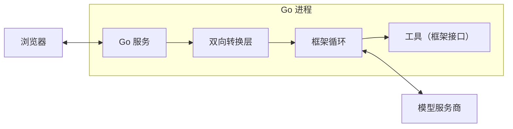
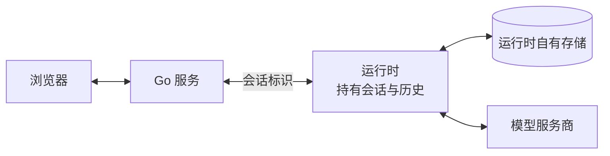
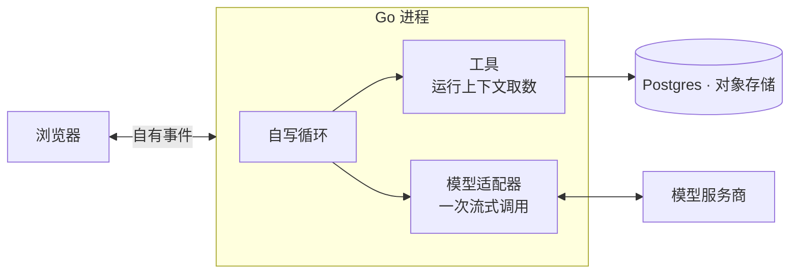

# 选型一：Agent 运行架构

> 所属：[Keine Explore Harness v1](../Keine_explore_harness_v1.md) · 附录 D
>
> 结论：**进程内自写工具循环，可替换的单位只有模型适配器。**

---

## 1. 问题

探索助手需要一个带工具循环的运行时：模型请求工具，服务端执行，结果回填，再继续，直到模型给出最终答案；整个过程以流式事件推给前端。这个运行时放在哪里、由谁掌握循环，决定了以下几件事：

- **部署形态**：单个二进制加 Postgres，还是多套运行时；
- **数据边界**：消息、事件、工具定义用谁的格式；
- **观测粒度**：进度事件和逐步用量能细到什么程度；
- **长期维护成本**：框架升级、协议变更的影响范围。

## 2. 评估维度

| 维度 | 说明 |
| --- | --- |
| 部署复杂度 | 是否引入新运行时、新进程、新的内部协议 |
| 边界自有 | 保存的消息、流式事件、工具定义能否保持 Keine 自有格式 |
| 工具权限 | 工具访问课程数据时，权限能否只在一处保证 |
| 观测与计量 | 进度事件粒度、逐步用量是否由 Keine 决定 |
| 服务商覆盖 | 对 OpenAI 兼容接口和 Anthropic Messages 的支持程度 |
| 成熟度 | 版本稳定性、维护活跃度、升级时的破坏性变更 |
| 实现成本 | 需要自行编写和测试的代码量 |

## 3. 候选架构

### 3.1 方案 A：Sidecar 运行时

在 Go 服务之外另起一个 Node 或 Python 进程，运行成熟的 Agent SDK（Vercel AI SDK、OpenAI Agents SDK、Pydantic AI 等）。Go 服务通过内部协议发起运行、中继事件；工具需要读取课程数据时，再回调 Go 服务。

| 优势 | 劣势 |
| --- | --- |
| 生态成熟，服务商覆盖最广 | 部署从「一个二进制加 Postgres」变成两套运行时 |
| 流式拼装、多服务商适配开箱即用 | 需要两条内部协议：运行请求与事件中继、工具回调 |
| — | 工具读数据要绕回 Go，权限在两处实现 |
| — | 多数 SDK 处于 0.x 阶段，大版本迭代频繁 |

### 3.2 方案 B：进程内框架托管循环

在 Go 进程内引入 Agent 框架（Genkit Go、Eino 等），由框架的生成接口管理整个工具循环。

| 优势 | 劣势 |
| --- | --- |
| 部署形态不变 | 消息、工具、事件三条边界都要在框架格式和自有格式之间双向转换 |
| 少写一个循环 | 进度事件的粒度、逐步用量取决于框架是否提供相应的钩子 |
| 框架吸收了部分服务商差异 | 框架升级可能打破转换层；换框架等于重写转换层 |
| — | 部分框架的工具错误默认让整个运行失败，需要额外改造 |

### 3.3 方案 C：自带会话的运行时

使用自己持有会话状态的运行时（ADK Go、LangGraph、Claude Agent SDK 等），由运行时保存历史，应用通过会话标识续接。

| 优势 | 劣势 |
| --- | --- |
| 会话管理、检查点、恢复能力完整 | 历史保存在运行时自己的格式里，与「边界自有」直接冲突 |
| — | 部分运行时对非本家模型的支持处于实验阶段，或不支持 OpenAI 兼容接口 |
| — | 依赖体量大，抽象层最厚 |

### 3.4 方案 D：进程内自写循环（选定）

工具循环写在 Keine 的 Go 服务中。唯一可替换的单位是模型适配器：它只负责一次流式调用，交出统一的增量、完整的工具调用、统一用量和结束原因。工具执行与权限、进度事件、步数、截止时间、取消、逐步计量、输出校验都在循环内。

| 优势 | 劣势 |
| --- | --- |
| 部署形态不变 | 循环、并行、超时、容错要自行实现和测试（规模在几百行） |
| 三条边界天然是自有格式，没有转换层 | 服务商差异要在适配器内自行吸收 |
| 工具直接通过运行上下文访问数据，权限只在一处保证 | 缓存标记、推理内容这类原生能力，要随服务商演进自行跟进 |
| 进度事件粒度、逐步计量完全自定 | — |
| 换服务商只换适配器，换框架不影响循环 | — |

## 4. 对比矩阵

| 维度 | A Sidecar | B 框架托管 | C 会话运行时 | **D 自写循环** |
| --- | --- | --- | --- | --- |
| 部署复杂度 | 高 | 低 | 中 | **低** |
| 边界自有 | 需中继转换 | 需双向转换 | 冲突 | **天然满足** |
| 工具权限 | 两处实现 | 一处 | 一处 | **一处** |
| 观测与计量 | 受 SDK 约束 | 受钩子约束 | 受运行时约束 | **完全自定** |
| 服务商覆盖 | 最广 | 广 | 偏本家 | 两个原生适配器 + 网关补足 |
| 成熟度风险 | SDK 迭代快 | 框架 0.x 或内部 SDK 版本落后 | 实验特性多 | **无外部依赖风险** |
| 实现成本 | 低 | 中 | 中 | 中 |

## 5. 结论与选择原因

选定方案 D：进程内自写循环。

1. **部署形态是硬约束。** Keine 的部署形态是单个二进制加 Postgres。方案 A 引入第二套运行时和两条内部协议，长期运维成本超过它在服务商覆盖上的收益。
2. **边界自有是核心原则。** 保存的消息、推给前端的事件、工具定义三条边界都要由 Keine 定义，换服务商、换框架只动适配器。方案 B 需要维护随框架升级而失效的转换层，方案 C 与这条原则直接冲突。
3. **循环本身并不复杂。** 探索助手的工具是少量只读工具加联网能力，循环的复杂度主要在容错和计量。这些恰恰是框架覆盖不好、又必须由 Keine 掌握的部分。
4. **服务商覆盖有更低成本的补足方式。** 原生实现 OpenAI 兼容和 Anthropic Messages 两个适配器，其余服务商通过各自的兼容端点或部署者的模型网关接入，Harness 只依赖 base URL。
5. **实现成本可控。** 自写循环的代价是几百行代码和对应的测试。这部分通过注入脚本化模型、可控时钟和故障工具的 HTTP 层测试覆盖。

**重新评估的条件**：需要执行代码等沙箱类工具时，重新评估独立进程方案。
