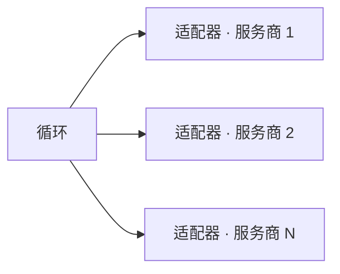
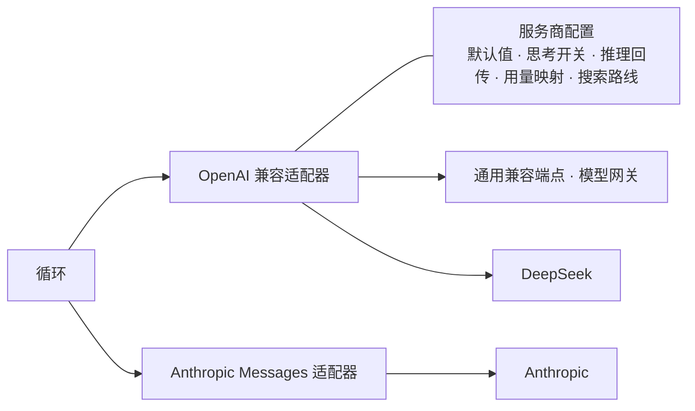

# 选型二：模型接入与适配器实现

> 所属：[Keine Explore Harness v1](../Keine_explore_harness_v1.md) · 附录 D
>
> 结论：**原生实现 OpenAI 兼容（自写 HTTP 与流解析）和 Anthropic Messages（官方 SDK）两个适配器；单个服务商的差异用「服务商配置」吸收，不新增适配器。**

---

## 1. 问题

模型适配器是 Harness 中唯一可替换的单位。这里有两个层面的选择：

- **接入粒度**：每个服务商一个适配器，只用一种通用接口，还是少量原生适配器加配置？
- **适配器实现**：用官方 SDK、框架的单次调用组件，还是直接用 HTTP 自行解析流？

适配器必须向上交出：

- 文本与推理增量；
- **完整的**工具调用；
- 统一用量（四项 token 互不重叠，另附推理小计）；
- 结束原因和失败类别。

## 2. 评估维度

| 维度 | 说明 |
| --- | --- |
| 工具调用拼装 | 能否正确拼装流式工具调用，包括并行调用与兼容端点的各种怪癖 |
| 统一用量 | 缓存命中与写入、流式用量的不同报告方式、累计值与增量值 |
| 推理内容 | 非标准字段的读取与回传 |
| 缓存能力 | 能否使用服务商的提示词缓存 |
| 取消 | 上下文取消后，请求和流能否立即停止 |
| 成熟度与体量 | 版本稳定性、升级风险、二进制体积与依赖数量 |

## 3. 接入粒度的候选

### 3.1 方案 A：每个服务商一个适配器

| 优势 | 劣势 |
| --- | --- |
| 每家的能力都能用足 | 适配器数量随服务商线性增长，维护成本高 |
| — | 大量服务商只是 OpenAI 兼容格式的变体，代码重复严重 |

### 3.2 方案 B：只用 OpenAI 兼容接口

| 优势 | 劣势 |
| --- | --- |
| 只有一个适配器 | Anthropic 的 OpenAI 兼容层不支持提示词缓存，也不建议用于生产 |
| 覆盖面广 | 推理内容、服务商自带搜索等原生能力无法使用 |

### 3.3 方案 C：两个原生适配器加服务商配置（选定）

| 优势 | 劣势 |
| --- | --- |
| 两种主流格式都用原生实现，能力完整 | 服务商配置需要随服务商的规则演进而维护 |
| 单个服务商的差异以配置形式挂在通用适配器上，不增加适配器 | — |
| 其余服务商经兼容端点或部署者的网关接入 | — |

## 4. 适配器实现的候选

### 4.1 候选对比

| 维度 | 官方 SDK | 框架的单次调用组件 | HTTP 自写 |
| --- | --- | --- | --- |
| 工具调用拼装 | 按 OpenAI 自家行为编写，对兼容端点有盲区：名称重复拼接、缺 index、按块累加用量 | 处理较完整，但内部 SDK 版本落后 | 由 Keine 决定，可完整覆盖已知怪癖 |
| 统一用量 | 流式累计值会被重复计数 | 取最后一次或最大值 | 自定义口径 |
| 推理内容 | 需要通过扩展字段自行处理 | 原生支持 | 自定义 |
| 依赖 | 体量较大 | 带入框架核心类型，需要双向转换 | 最小 |
| 升级风险 | 版本发布频繁，小版本偶有破坏性变更 | 随框架升级失效 | 无外部风险，跟进全靠自己 |

### 4.2 OpenAI 兼容适配器：HTTP 自写

兼容端点的主要风险在怪癖。官方 SDK 的流式累加器对兼容端点有已知盲区：

- 续传分块重复发送工具名时，名称会被重复拼接；
- 缺少 index 时，多个工具调用被错误合并；
- 用量是累计值时被逐块相加，导致重复计数；
- 推理字段不在类型定义中。

使用官方 SDK 时，这些问题都要在外面再包一层处理，SDK 实际提供的只剩类型定义和流解码，却要付出可观的依赖体积。自写 HTTP 与流解析能直接按已知的怪癖清单实现，同时保持最小体量；代价是资源上限、错误分类、重试等防御都要自行编写和测试。

### 4.3 Anthropic 适配器：官方 SDK

Anthropic Messages 协议本身规整，按内容块区分，没有兼容端点的那些怪癖。官方 SDK 已经正确处理累计用量与截断，也是唯一紧跟最新 API 版本的实现。框架插件内部使用的 SDK 版本落后，不予采用。

## 5. 结论与选择原因

选定：**两个原生适配器加服务商配置**。OpenAI 兼容适配器自写 HTTP 与流解析，Anthropic 适配器使用官方 SDK。

1. **覆盖与成本的平衡。** OpenAI Chat Completions 是所有服务商共有的兜底格式，Anthropic Messages 是第二种事实标准。两个原生适配器覆盖主流，其余服务商经兼容端点或模型网关接入，不随服务商数量增加代码。
2. **Anthropic 必须原生接入。** 它的兼容层不支持提示词缓存，也不建议用于生产；服务商自带搜索、推理签名回传都只有原生接口才能使用。
3. **差异以配置吸收。** 默认地址、思考开关、推理回传、用量字段映射、搜索路线，都属于「同一格式下的规则差异」，用服务商配置表达即可，不需要新的适配器。
4. **实现方式按协议特点区分。** 兼容端点怪癖多，自写才能完全掌控；Anthropic 协议规整、迭代快，官方 SDK 的维护优势更大。
5. **统一用量的口径由 Keine 先定。** 四项 token 互不重叠：输入不含缓存命中。各适配器按这一口径映射，用量统计因此不依赖服务商的报告方式。
