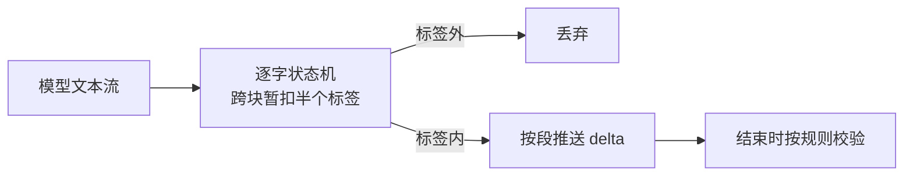

# 选型三：结构化输出与最终答案判定

> 所属：[Keine Explore Harness v1](../Keine_explore_harness_v1.md) · 附录 D
>
> 结论：**三段标签包裹，配合流式标签解析器和服务端校验；没有工具调用的那一步即为最终答案；预算耗尽后发一次保留工具声明、禁止使用工具的作答调用。**

---

## 1. 问题

分析的结果是结构固定的三段：标题、简介、含义。在工具循环里输出这样的结构，要同时回答四个问题：

1. **结构放在哪里**：提示词约定、服务商的结构化能力、工具参数，还是文本标签？
2. **最终答案怎么判定**：如何区分中间说明和最终正文？
3. **怎么流式**：读者能否逐字看到正文？
4. **怎么校验和收尾**：格式不合格、步数耗尽时怎么办？

## 2. 评估维度

| 维度 | 说明 |
| --- | --- |
| 跨服务商可用 | 不依赖个别服务商的特性 |
| 逐字流式 | 正文能否在生成过程中逐字推送 |
| 中间文字隔离 | 说明性文字是否会混入结果 |
| 与工具共存 | 与函数工具、服务商自带搜索能否同时使用 |
| 校验与补救 | 能否确定性地发现格式问题，并修复 |
| 缓存与成本 | 是否额外增加调用次数，是否破坏缓存前缀 |

## 3. 候选方案

### 3.1 方案 A：Markdown 约定加提示词

只靠提示词约定 Markdown 结构，以「没有工具调用的那一步」为最终答案，事后解析标题层级来校验。

| 优势 | 劣势 |
| --- | --- |
| 改动最小，所有服务商可用 | 流式与「不混入中间文字」只能二选一：要么缓冲到步结束，要么推送后再撤回 |
| — | 格式只能事后校验，结构识别不确定 |

### 3.2 方案 B：标签包裹加流式解析（选定）

三段分别用标签包裹。流式解析器逐字切分：标签外的文字不推送，标签内的内容按段推送。

| 优势 | 劣势 |
| --- | --- |
| 逐字流式，标签一出现即可确定是正文 | 要自行编写和测试流式解析器 |
| 标签缺失、段落缺失可以确定性地发现 | 模型漏写标签时需要补救路径 |
| 与工具调用、服务商自带搜索天然兼容 | — |
| 不依赖任何服务商特性；Anthropic 官方推荐用标签引导格式 | — |

### 3.3 方案 C：「提交结果」工具

定义一个参数为三段的工具，模型调用它即结束循环，答案只从工具参数中读取。

| 优势 | 劣势 |
| --- | --- |
| 参数校验与错误回填路径最成熟 | 不能强制调用：最新一批 Claude 模型拒绝强制工具调用，智谱只支持自动选择，DeepSeek 与通义在思考模式下不支持强制 |
| — | 正文放在 JSON 字符串里，逐字流式要增量解析转义；部分服务商需要额外开关才会逐步下发工具参数 |
| — | 必须处理「模型写了一段文字就结束、没有调用工具」的情况 |

### 3.4 方案 D：服务商原生 JSON Schema

使用服务商的受限解码能力，直接输出符合 Schema 的 JSON。

| 优势 | 劣势 |
| --- | --- |
| 解码层面保证结构 | DeepSeek、智谱不支持 JSON Schema，只支持 JSON 模式 |
| — | Anthropic 的原生 JSON 输出与引用能力不兼容；改动输出格式会让缓存失效 |
| — | 无法作为跨服务商的基线 |

### 3.5 方案 E：两段式（检索与作答分开调用）

循环只做检索，文字一律不展示；最后单独发一次禁止使用工具的调用来写三段。

| 优势 | 劣势 |
| --- | --- |
| 最终答案的判定确定无疑 | 每次运行固定多一次调用 |
| 预算收尾与正常收尾走同一条路径 | 循环最后一步已经写出答案时，这次调用是重复花费 |
| — | 改动工具选择或删除工具会破坏缓存前缀 |

## 4. 对比矩阵

| 维度 | A Markdown | **B 标签** | C 提交工具 | D 原生 Schema | E 两段式 |
| --- | --- | --- | --- | --- | --- |
| 跨服务商可用 | ✓ | **✓** | 受强制调用限制 | ✗ | ✓ |
| 逐字流式 | 需撤回机制 | **✓** | 需增量解析转义 | 视服务商而定 | ✓ |
| 中间文字隔离 | 弱 | **✓** | ✓ | ✓ | ✓ |
| 与工具共存 | ✓ | **✓** | ✓ | 部分冲突 | ✓ |
| 校验确定性 | 弱 | **强** | 强 | 强 | 视组合而定 |
| 额外调用 | 无 | **无（仅补救时）** | 无 | 无 | 每次 +1 |

## 5. 收尾策略的候选

步数预算耗尽时的处理同样有多种做法：

| 做法 | 结果 |
| --- | --- |
| 直接报错 | 读者拿不到任何结果，已消耗的用量照算 |
| 返回固定文字 | 不是三段结构，界面要单独呈现 |
| 接近上限时提示，用完后发一次禁止使用工具的作答调用 | **读者总能拿到三段结果** |

## 6. 结论与选择原因

选定：**方案 B（标签包裹 + 流式解析 + 服务端校验）**，以「没有工具调用的那一步」为最终答案，搭配「提示剩余预算 + 作答调用」的收尾策略。

1. **跨服务商是硬约束。** 方案 C 受强制调用的限制，方案 D 在主要服务商上不可用，都不能作为基线。
2. **逐字流式与隔离兼得。** 标签让解析器在生成过程中就能确定哪些是正文，不需要撤回机制，也不需要缓冲。
3. **草稿作废有明确语义。** 某一步写了标签却以工具调用结束时，发送 `reset`，前端清空草稿、恢复进度显示，事件协议只需增加一个标志。
4. **成本最低。** 正常路径不增加调用；只在答复不合格且读者尚未看到正文时补救一次。
5. **收尾保证结果。** 作答调用保留工具声明并设 `tool_choice: none`，既保住缓存前缀，又避免部分服务商在「历史有工具调用、请求不带工具」时把原始的工具调用标记写进正文。解析器把原始的工具调用标记判为不合格，作为兜底。
