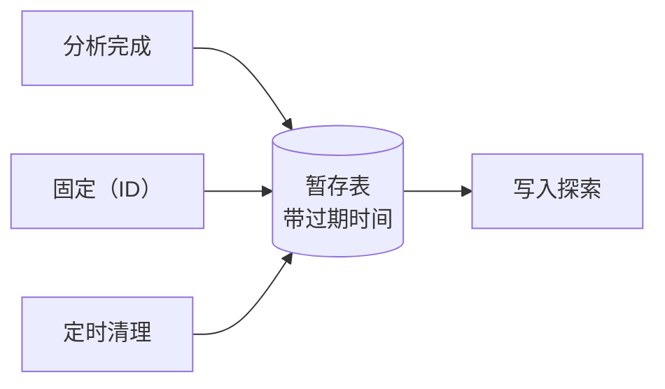
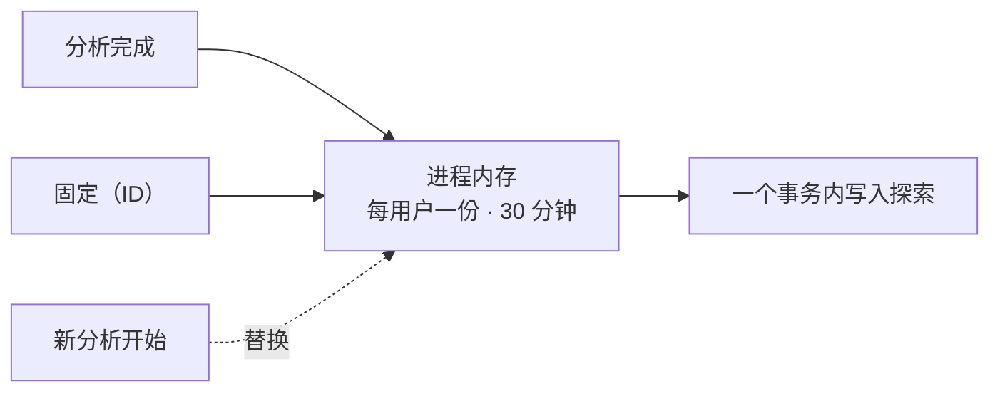

# 选型四：未固定结果的暂存

> 所属：[Keine Explore Harness v1](../Keine_explore_harness_v1.md) · 附录 D
>
> 结论：**服务端进程内存暂存，前端凭不透明 ID 固定；每用户一份，30 分钟过期。**

---

## 1. 问题

分析完成后，读者可能固定结果，也可能放弃。固定时要写入的内容包括：

- **快照**：注入上下文的请求消息；
- **首轮回复**：模型的最终回复；
- **三段结果**：校验通过的三段。

这些内容在固定之后会作为后续每一轮对话的前缀发给模型。所以要回答两个问题：固定之前，这份内容放在哪里？固定时，由谁提交？

需要面对的事实：

- **快照体积大**：包含整讲正文、课程信息，往往有几万 token；
- **回复不可重建**：模型的回复和检索过程是非确定性的，无法事后重新生成；
- **缓存要求前缀一致**：提示词缓存要求前缀逐字节一致，任何重新序列化都会导致缓存未命中；
- **服务商不辨真伪**：服务商接口无法分辨历史中的助手轮次是否被伪造。

## 2. 评估维度

| 维度 | 说明 |
| --- | --- |
| 防篡改 | 客户端能否伪造回复、注入提示词 |
| 留痕 | 未固定的结果是否写入持久存储 |
| 清理 | 过期数据是否需要额外的清理机制 |
| 重启影响 | 服务重启后能否固定 |
| 传输量 | 固定时客户端与服务端之间传输的数据量 |
| 前缀一致性 | 固定后的前缀是否与首轮实际请求逐字节一致 |

## 3. 候选方案

### 3.1 方案 A1：数据库暂存表

| 优势 | 劣势 |
| --- | --- |
| 重启后仍能固定 | 每次分析都要写入几十到几百 KB，大部分最终并不固定，写放大明显 |
| 无篡改风险 | 需要定时清理，读取时还要按过期时间过滤 |
| — | 读者以为没保存的内容，在过期前留在了库中 |

### 3.2 方案 A2：进程内存暂存（选定）

| 优势 | 劣势 |
| --- | --- |
| 不落盘，未固定的结果不留痕 | 重启后丢失，表现为固定失败 |
| 无篡改风险，客户端只持有不透明 ID | 占用进程内存 |
| 不需要额外的表和定时任务 | — |
| 前缀与首轮请求逐字节一致 | — |

### 3.3 方案 B1：前端明文回传

| 优势 | 劣势 |
| --- | --- |
| 服务端无状态，无清理和重启问题 | 客户端可以伪造回复、在快照中注入任意提示词，而这些内容会作为可信前缀进入之后的每一轮，相当于持久化的提示词注入 |
| — | 上行传输几万 token |

### 3.4 方案 B2：签名或加密回传

服务端对「快照 + 回复」计算签名或加密后交给客户端，固定时验签。

| 优势 | 劣势 |
| --- | --- |
| 服务端无状态，可防篡改，重启不影响 | 下行和上行都要传输整段内容 |
| — | 签名必须绑定用户、选区、过期时间，以防重放 |
| — | 需要配置和轮换密钥 |

### 3.5 方案 C：服务端重建快照，客户端提交回复

| 优势 | 劣势 |
| --- | --- |
| 快照由服务端重建，可信 | 回复仍由客户端提交，依然是被注入的内容 |
| — | 首轮的检索过程无法重建；前缀一致性取决于重建是否确定 |

## 4. 对比矩阵

| 维度 | A1 数据库 | **A2 内存** | B1 明文回传 | B2 签名回传 | C 重建 + 回传 |
| --- | --- | --- | --- | --- | --- |
| 防篡改 | ✓ | **✓** | ✗ | ✓ | 仅回复有风险 |
| 不留痕 | 留到过期 | **✓** | ✓ | ✓ | ✓ |
| 清理 | 定时任务 | **进程内过期** | 无需 | 无需 | 无需 |
| 重启后可固定 | ✓ | **✗** | ✓ | ✓ | 视课程版本而定 |
| 传输量 | 只传 ID | **只传 ID** | 上行整段 | 双向整段 | 上行回复 |
| 前缀一致 | ✓ | **✓** | 取决于客户端 | ✓ | 取决于重建 |

## 5. 结论与选择原因

选定：**方案 A2，进程内存暂存**。

1. **安全优先。** 首轮内容会成为之后每一轮的可信前缀，客户端不能参与提交。这直接排除了 B1 和 C。
2. **不留痕符合产品承诺。** 没固定的分析不应留下任何记录。A2 不落盘，最贴合这一点；A1 会在过期前留下记录，还要多一张表和定时清理。
3. **传输最小。** 固定只提交不透明 ID。B2 虽然安全，但每次都要双向传输几十 KB 的内容，还要管理密钥。
4. **重启的代价可以接受。** 重启丢失暂存，与流式中断的代价相同：读者在悬浮框中仍保留内容，重试即可。
5. **语义简单。** 每个用户只保留一份，新分析开始即替换旧的；出错、不合格、中断的运行不暂存；过期或被替换后返回 `analysis_expired`。
