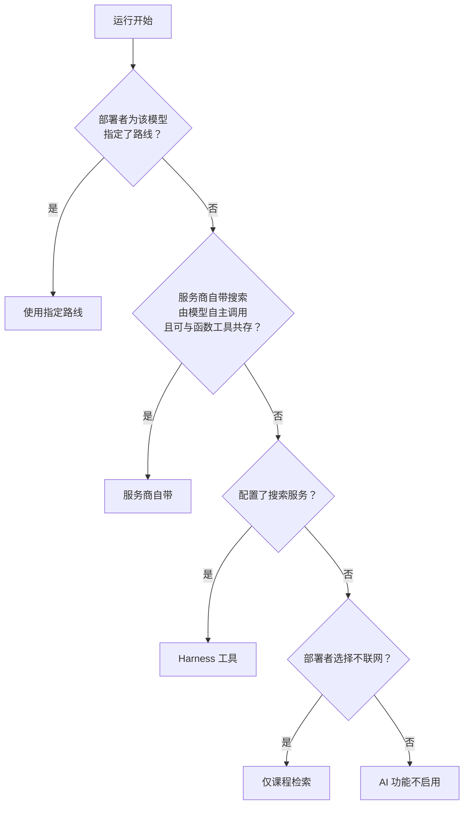

# 选型五：联网搜索路线

> 所属：[Keine Explore Harness v1](../Keine_explore_harness_v1.md) · 附录 D
>
> 结论：**联网搜索和网页抓取作为两项「能力」，每次运行按模型解析路线：满足条件时走服务商自带，否则走 Harness 工具（背后是可替换的搜索服务适配器）；是否检索由模型决定。**

---

## 1. 问题

助手需要课程之外的资料时，要能搜索网络、读取网页。这里要决定：

- **执行方**：搜索由谁执行，模型服务商，还是 Harness 自己？
- **调用方式**：搜索如何被调用，作为工具由模型决定，还是由应用强制注入？
- **计费与凭据**：费用记在谁的账上，凭据由谁提供？
- **多服务商形态**：各家的搜索形态差异很大，怎么统一？

需要面对的事实：

- **形态不统一**：服务商自带搜索的形态各不相同，有的作为工具由模型自主调用，有的只能强制搜索，有的不能与函数工具同时声明。
- **计费方式不同**：搜索服务按次计费，各家口径也不同，有的只对成功且有结果的请求计费。
- **服务器要访问外网**：抓取网页意味着服务器主动访问外部地址。

## 2. 评估维度

| 维度 | 说明 |
| --- | --- |
| 检索质量 | 结果相关性与时效性 |
| 与函数工具共存 | 能否和课程工具在同一请求中声明 |
| 模型自主 | 搜不搜由模型决定，还是被强制 |
| 可观测 | 能否产出统一的进度事件、来源清单、计费次数 |
| 凭据与成本归属 | 费用记在谁的账户上，凭据如何管理 |
| 安全边界 | 服务器主动访问外网的范围是否受控 |
| 适配成本 | 每接入一家需要的工作量 |

## 3. 候选方案

### 3.1 方案 A：只用服务商自带搜索

| 优势 | 劣势 |
| --- | --- |
| 检索质量通常更好 | 只有部分服务商提供可与函数工具共存、由模型自主调用的形态 |
| Harness 不执行网络请求 | 每家的结果格式、引用、计费字段、互斥规则都要在适配器中吸收 |
| — | 不支持的模型就没有联网能力 |

### 3.2 方案 B：只用 Harness 工具

| 优势 | 劣势 |
| --- | --- |
| 所有支持函数工具的模型都能联网 | 检索质量取决于第三方搜索服务 |
| 进度事件、来源清单、计费判定全部由 Harness 掌握 | 需要额外的搜索服务凭据 |
| 抓取范围可以严格受控 | — |

### 3.3 方案 C：应用侧强制检索后注入（RAG 式）

先让模型生成检索词，由应用执行搜索，再把结果拼进上下文作答。

| 优势 | 劣势 |
| --- | --- |
| 不依赖函数调用能力 | 每次运行都检索，不由模型判断是否需要 |
| — | 多一次调用，检索与作答割裂 |
| — | 与课程工具的统一循环不一致 |

### 3.4 方案 D：按模型解析路线（选定）

| 优势 | 劣势 |
| --- | --- |
| 服务商自带搜索可用时享受其检索质量 | 两条路线都要实现，并统一成同一套进度、来源与失败原因 |
| 不支持时自动退到 Harness 工具，所有模型都能联网 | — |
| 部署者可以按模型指定路线，决定搜索花谁的钱 | — |

## 4. 不予支持的服务商形态

| 形态 | 不支持的原因 |
| --- | --- |
| 只能强制搜索 | 每次调用都先检索再作答，检索不由模型决定，与「是否检索由模型决定」冲突 |
| 不能与函数工具共存 | 与函数工具同时声明时请求被拒绝，或者模型不会调用该搜索，无法与课程工具同处一个循环 |

## 5. 对比矩阵

| 维度 | A 只用自带 | B 只用工具 | C 强制注入 | **D 按模型解析** |
| --- | --- | --- | --- | --- |
| 检索质量 | 高 | 中 | 中 | **自带可用时高** |
| 模型覆盖 | 部分 | 全部（需支持函数工具） | 全部 | **全部** |
| 模型自主 | ✓ | ✓ | ✗ | **✓** |
| 可观测 | 依赖适配器映射 | 完全掌握 | 完全掌握 | **统一映射** |
| 抓取范围受控 | 服务商侧 | ✓ | ✓ | **✓** |
| 适配成本 | 每家单独吸收 | 每个搜索服务一个适配器 | 低 | 两者之和 |

## 6. 结论与选择原因

选定：**方案 D，按模型解析路线**。

1. **质量与覆盖兼顾。** 服务商自带搜索的质量通常更好，但只有部分服务商提供合适的形态。按模型解析，可以在能用时用最好的，不能用时仍有联网能力。
2. **模型自主检索。** 搜不搜由模型决定（`tool_choice: auto`），与课程工具同处一个循环，检索与推理不割裂。方案 C 被排除。
3. **路线定义：**
   - Anthropic 走服务商自带的搜索和抓取；
   - DeepSeek 走 Harness 工具，接入 DeepSeek 自己的 Search 与 Fetch 接口，与模型共用凭据；它的内置搜索不能与函数工具共存，所以不用；
   - 其他 OpenAI 兼容模型走 Harness 工具，接入 Tavily，只提供搜索。
4. **统一的观测与计费。** 两条路线产出同样的进度事件、来源清单和失败原因。搜索次数只统计搜索服务实际计费的请求，由搜索服务适配器判定。
5. **安全边界。** 网页抓取只能访问本次运行搜索结果中出现过的 URL，杜绝模型臆造地址，也把服务器主动访问外网的范围限定在搜索结果之内。
