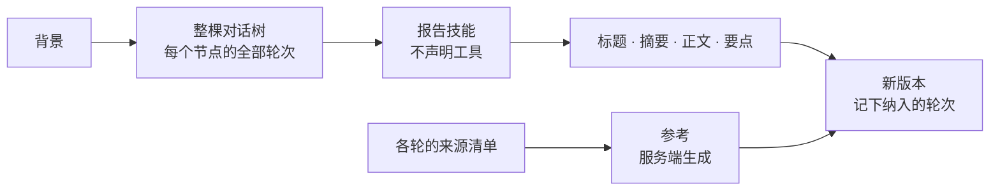

# 选型七：对话成果的沉淀

> 所属：[Keine Explore Harness v1](../Keine_explore_harness_v1.md) · 附录 D
>
> 结论：**探索文档只有分析生成的三段，固定后不变；对话的成果由探索报告承载：读完整棵对话树写出，每生成一次多一个版本。**

---

## 1. 问题

探索对话是一棵树，读者在各个节点上往深处问、横向展开、跳出主题。讨论清楚的内容散落在各个节点的各轮里，需要一个地方沉淀下来，并且能脱离对话单独阅读。

需要面对的事实：

- **探索文档身兼两职**：它既是阅读页探索卡片上的简短概念说明，又可能承担对话之后的成果汇总，两者对篇幅和结构的要求相反；
- **对话是树，不是线**：成果分布在多条祖先链上，从任何一轮出发都只看得到自己的那条链；
- **对话会修正自己**：后面的轮次可能更正前面的说法，按时间拼接会留下矛盾；
- **参考要可信**：来源只能是对话里实际查阅过的资料，不能由模型编写。

## 2. 评估维度

| 维度 | 说明 |
| --- | --- |
| 可读性 | 没看过对话的人能否单独读懂 |
| 卡片精简 | 阅读页上的探索文档能否保持简短 |
| 协议复杂度 | 需要维护的修改协议、校验和撤销机制 |
| 读者掌控 | 读者能否找回、比较自己生成过的内容 |
| 成本 | 每次沉淀的模型调用 |

## 3. 候选方案

### 3.1 方案 A：同步回探索文档

| 优势 | 劣势 |
| --- | --- |
| 文档与对话始终一致 | 要维护修改块协议、条数上限、链路隔离校验、修订与撤销 |
| 成果直接挂在原文位置上 | 文档越同步越长，探索卡片放不下 |
| — | 每次只看到一条祖先链，跨节点的内容无法汇总 |

### 3.2 方案 B：导出对话记录

| 优势 | 劣势 |
| --- | --- |
| 不调用模型，免费，忠实于对话 | 只是对话记录，不是文档；前后矛盾原样保留 |
| 实现最简单 | 不保存，读者找不回生成过的内容 |

### 3.3 方案 C：探索报告按版本生成（选定）

| 优势 | 劣势 |
| --- | --- |
| 按内容组织成说明文档，可以单独阅读 | 每次生成都要读完整棵树，输入体积随对话增长 |
| 探索文档固定不变，卡片保持精简 | 树超出模型的输入上限时无法生成 |
| 不需要修改协议和撤销；版本只增不改 | 报告与对话之间不实时一致，要读者再次生成 |
| 参考由服务端从来源清单生成 | — |

## 4. 对比矩阵

| 维度 | A 同步 | B 导出记录 | **C 探索报告** |
| --- | --- | --- | --- |
| 可读性 | 好，但只含一条链 | 差：对话原文 | **好：按内容组织** |
| 卡片精简 | ✗ | ✓ | **✓** |
| 协议复杂度 | 高 | 无 | **低** |
| 读者掌控 | 修订可撤销 | ✗ | **按版本保存** |
| 成本 | 每次一轮 | 无 | **每次一轮** |

## 5. 结论与选择原因

选定：**方案 C，探索报告按版本生成**。

1. **两种用途分开。** 探索文档就是分析的结果，固定后不变，阅读页上保持最小；对话的成果另成一份文档，篇幅和结构不受卡片约束。
2. **读整棵树才能汇总。** 报告的输入是全部节点的全部轮次，跨节点、互相补充的内容合在一处讲，对话中的更正以最后讲清楚的为准。
3. **复杂度大幅下降。** 不需要修改块、条数上限、链路隔离和撤销；每次生成只追加一个版本。
4. **参考可信。** 模型不写链接，参考由服务端汇总各轮实际执行的搜索和抓取。
5. **超长的代价可控。** 树超出输入上限时运行前拒绝，不扣积分；输入上限为模型窗口减去报告的输出上限。
