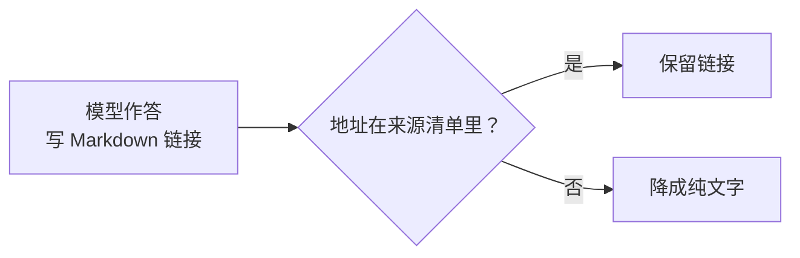
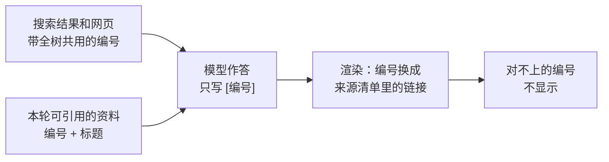

# 选型九：对话回复里的资料引用

> 所属：[Keine Explore Harness v1](../Keine_explore_harness_v1.md) · 附录 D
>
> 结论：**探索对话的回复用编号引用网络资料：搜索结果和读过的网页带编号，编号在整棵对话树里共用，同一个地址只有一个编号；模型只写编号，系统按编号换成来源清单里记录的链接，对不上的编号不显示。**

---

## 1. 问题

读者在探索对话里请助手「找几篇相关的论文并给出链接」时，拿不到任何链接：回复不允许写链接，来源清单只记录、不显示。

需要面对的事实：

- **模型会编造地址**：凭记忆写出的论文链接常常不存在，或者指向另一篇；
- **信任比数量重要**：读者点开一个不存在的链接，损失的是对整个助手的信任；
- **来源清单已经可信**：服务端按实际执行的搜索和抓取记录了标题和地址；
- **对话是一棵树**：一轮只看得到祖先链上的内容，兄弟节点里找到的资料它没见过；
- **前缀缓存**：同一节点里，每一轮的请求以上一轮的请求开头。

## 2. 评估维度

| 维度 | 说明 |
| --- | --- |
| 链接可信 | 显示出来的链接是否一定是本次对话实际搜到或读过的 |
| 模型负担 | 模型要写的东西是否简单、不易出错 |
| 维护成本 | 是否需要额外的校验逻辑 |
| 跨轮一致 | 后续轮引用前几轮的资料时，引用是否稳定 |

## 3. 候选方案

### 3.1 方案 A：模型直接写 Markdown 链接，只靠提示词约束

| 优势 | 劣势 |
| --- | --- |
| 模型最顺手，实现最简单 | 编造或抄错的地址原样显示 |
| — | 没有事后校验 |

### 3.2 方案 B：模型写链接，服务端对照来源清单校验

| 优势 | 劣势 |
| --- | --- |
| 模型照常写链接 | 地址的规范化和比对要自己维护 |
| 编造的地址不会成为链接 | 标题和地址可能错配：文字写的是一篇，地址指向另一篇 |

### 3.3 方案 C：编号引用，系统按编号生成链接（选定）

| 优势 | 劣势 |
| --- | --- |
| 显示的链接一定来自来源清单 | 模型要学会只写编号 |
| 模型不写地址，写错的余地小 | 编号要在整棵树里保持稳定 |
| 同一地址在整段对话里是同一个引用 | 引用以标签形式出现，不能写成文字链接 |

## 4. 对比矩阵

| 维度 | A 只靠提示词 | B 事后校验 | **C 编号引用** |
| --- | --- | --- | --- |
| 链接可信 | 无保证 | 地址可信，标题可能错配 | **地址和标题都来自清单** |
| 模型负担 | 最低 | 低 | **低：只写编号** |
| 维护成本 | 无 | 地址比对 | **编号表** |
| 跨轮一致 | — | — | **整棵树共用编号** |

## 5. 结论与选择原因

选定：**方案 C，编号引用，系统按编号生成链接**。

1. **链接只来自来源清单。** 模型写不出地址，编造的编号对不上，直接不显示。
2. **编号全树共用。** 同一个地址在整段对话里只有一个编号，后续轮引用前几轮的资料时编号不变；删除节点后空出的编号可以再用，因为引用过它的回复已随节点删除。
3. **只能引用看得到的资料。** 一轮可引用的是祖先链各轮和本轮记下的资料；提问开头列出前者的编号和标题，不带地址；兄弟节点的资料不列出，它的编号在这一轮也对不上。
4. **只看过摘要也可以引用。** 保证的是链接真实、模型见过，不保证读过全文。
5. **只放开对话回复。** 探索文档仍然不写链接，探索报告的参考仍由系统从来源清单生成。
6. **没有联网时说明。** 本轮没有搜索工具或搜索不可用时，回复说明这次没法查找，只给名称、不给链接。
